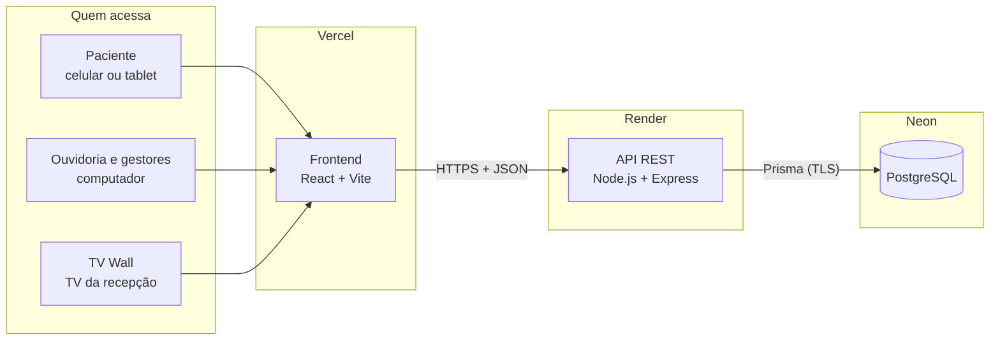
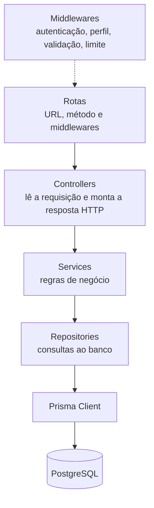
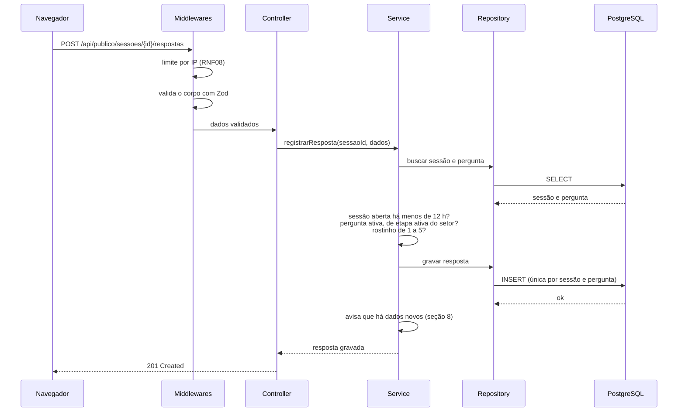
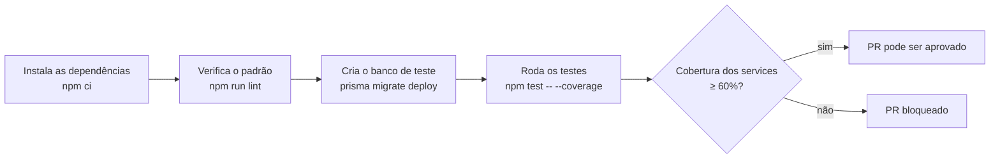

# Arquitetura do Backend — Pesquisa de Satisfação FHDOD

**Versão:** 1.0 — 16/10/2026
**Base:** [Documento de Requisitos](Documento_de_Requisitos_FHDOD.md) v1.13 e [Modelo de Dados](modelo-de-dados-e-requisitos.md) v1.0

Este documento descreve como o backend é organizado: as tecnologias, as camadas, os padrões de projeto, o contrato da API e as decisões que garantem manutenibilidade, segurança e escalabilidade. Os detalhes de segurança e hospedagem estão em [`seguranca-e-nuvem.md`](seguranca-e-nuvem.md), e as consultas ao banco em [`mapeamento-classes-e-consultas.md`](mapeamento-classes-e-consultas.md).

---

## 1. Visão geral

O sistema tem três partes publicadas em serviços de nuvem gratuitos (RNF02):



O navegador baixa o frontend da Vercel e conversa com a API no Render; **só a API acessa o banco**. O frontend nunca recebe credenciais do banco, e toda regra de negócio é verificada no servidor, mesmo que a tela já a respeite.

---

## 2. Tecnologias

| Tecnologia | Versão-alvo | Uso | Por que esta |
| --- | --- | --- | --- |
| Node.js | 24 LTS | Ambiente de execução | Definido no RNF01; versão com suporte longo até 2028 |
| Express | 5 | Servidor HTTP e rotas | Definido no RNF01; a versão 5 trata erros de funções `async` sem código extra |
| Prisma | 6 | Acesso ao banco e migrações | Definido no RNF01; consultas parametrizadas por padrão (RNF09) |
| PostgreSQL | 17 (Neon) | Banco de dados | Justificado no modelo de dados, seção 1 |
| Zod | 4 | Validação de entradas e das variáveis de ambiente | Um único esquema valida os dados e gera mensagens de erro claras |
| jsonwebtoken | — | Tokens de acesso (JWT) | RNF08 |
| bcryptjs | — | Hash de senhas | RNF09; implementação em JavaScript puro, sem compilação nativa no Render ou no Windows |
| helmet, cors, express-rate-limit | — | Cabeçalhos de segurança, origem permitida e limite de requisições | RNF08, RNF09 |
| sanitize-html | — | Remoção de HTML dos textos livres | RNF09 |
| multer | — | Recebimento de arquivos (planilha e fotos) | RF17, RF21 |
| ExcelJS | — | Leitura da escala e exportação em Excel | RF21, RF29 |
| PDFKit | — | Relatório mensal em PDF | RF29 |
| swagger-ui-express | — | Página da documentação da API | RNF13 |
| pino-http | — | Registro das requisições | Logs estruturados e sem dados pessoais |
| Jest + Supertest | 30 / 7 | Testes unitários e de integração | RNF13 |
| ESLint + Prettier | — | Padrão de código | Revisões focadas na lógica, não na formatação |

As versões exatas ficam travadas no `package-lock.json`, para que todos os ambientes instalem as mesmas.

O backend é escrito em **JavaScript com módulos CommonJS** (`require`). O TypeScript traria verificação de tipos, mas exigiria uma etapa de compilação e configuração extra no Jest e no Prisma. Neste projeto, a validação com Zod em todas as entradas da API cobre o ponto em que os erros de tipo mais acontecem: os dados que chegam de fora.

---

## 3. Arquitetura em camadas

O backend segue a arquitetura em camadas definida no RNF13. Cada camada tem uma única responsabilidade e só conversa com a camada logo abaixo:



| Camada | Responsabilidade | Não pode |
| --- | --- | --- |
| **Rotas** | Associar URL e método ao controller e encadear os middlewares (autenticação, perfil, validação) | Ter lógica |
| **Controllers** | Extrair dados já validados da requisição, chamar o service e devolver o status HTTP e o JSON | Acessar o banco ou decidir regras de negócio |
| **Services** | Aplicar as regras de negócio (RN01–RN11), coordenar transações e calcular indicadores | Conhecer `req`, `res` ou códigos HTTP |
| **Repositories** | Executar as consultas no banco e devolver objetos simples | Ter regras de negócio |

Por que essa separação importa aqui:

- **Testes:** os services não dependem do Express nem do banco. São testados com repositories falsos (*mocks*), de forma rápida e isolada. É neles que está a cobertura mínima de 60% exigida pelo RNF13.
- **Mudança localizada:** se a forma de calcular o NPS mudar, muda um service; se uma consulta ficar lenta, muda um repository. Nenhuma das duas mudanças toca nas rotas.
- **Revisão:** cada PR mexe em poucos arquivos com papel claro, o que facilita a revisão cruzada da dupla.

---

## 4. Organização das pastas

O código é organizado **por módulo** (uma pasta por assunto do sistema), e cada módulo tem um arquivo por camada. Assim, tudo o que trata de manifestações fica junto, sem perder a separação em camadas.

```text
backend/
├── prisma/
│   ├── schema.prisma          # modelo de dados
│   ├── migrations/            # scripts DDL gerados (seção 4 de padroes-banco-de-dados.md)
│   └── seed.js                # povoamento inicial (DML)
├── src/
│   ├── app.js                 # monta o Express (sem iniciar o servidor)
│   ├── server.js              # inicia o servidor
│   ├── config/
│   │   ├── env.js             # lê e valida as variáveis de ambiente
│   │   ├── prisma.js          # instância única do Prisma Client
│   │   └── regras.js          # números das regras de negócio (prazos e limites)
│   ├── middlewares/           # autenticar, exigirPerfil, validar, limitarRequisicoes, tratarErros
│   ├── repositories/          # repositories usados por vários módulos (ex.: auditoria)
│   ├── utils/                 # turnos, horasUteis, telefone, cripto, sanitizar, datas, AppError,
│   │                          # versaoDados, cache, paginacao e nomes
│   ├── docs/
│   │   ├── openapi.base.yaml  # parte comum do contrato: informações, segurança e formato de erro
│   │   └── swagger.js         # junta o base com o contrato de cada módulo e publica o Swagger
│   └── modules/
│       ├── auth/
│       ├── pesquisa/          # rotas públicas (sessões, respostas, nota, manifestação) e formulários de papel
│       ├── setores/
│       ├── etapas/            # etapas da jornada de cada setor
│       ├── turnos/
│       ├── equipes/
│       ├── usuarios/
│       ├── escalas/
│       ├── atendimentos/
│       ├── perguntas/
│       ├── termos/
│       ├── manifestacoes/     # Ouvidoria: lista, classificação, tentativas, finalização, anexos
│       ├── indicadores/       # dashboard, exportação e relatório
│       └── tvwall/
└── tests/
    ├── unit/                  # services e utils
    ├── integration/           # rotas com Supertest e banco de teste
    ├── helpers/               # limpeza do banco e criação de dados de teste
    ├── globalSetup.js         # aplica as migrações no banco de teste antes da suíte
    └── setup.js               # zera os limites de requisição antes de cada teste
```

A pasta `src/repositories/` guarda os repositories que **vários módulos** usam, como o de auditoria (RNF11): manifestações, perguntas e usuários registram log, e nenhum desses módulos é "dono" da tabela `log_auditoria`. Os repositories de um módulo só ficam dentro do próprio módulo.

Cada módulo segue o mesmo formato:

```text
modules/manifestacoes/
├── manifestacoes.routes.js
├── manifestacoes.controller.js
├── manifestacoes.service.js
├── manifestacoes.repository.js
├── manifestacoes.schemas.js   # esquemas Zod das entradas
└── manifestacoes.openapi.yaml # contrato das rotas do módulo (seção 7)
```

O `app.js` monta a aplicação sem chamar `listen`. Assim, os testes de integração usam a aplicação diretamente com o Supertest, sem abrir uma porta de rede.

---

## 5. Padrões de projeto

| Padrão | Onde | Benefício |
| --- | --- | --- |
| **Arquitetura em camadas** | Todo o backend (seção 3) | Separação de responsabilidades (RNF13) |
| **Repository** | `*.repository.js` | Isola o acesso a dados; os services não sabem que existe Prisma |
| **Service Layer** | `*.service.js` | Um único lugar para cada regra de negócio |
| **Injeção de dependências** | Services criados por funções que recebem os repositories | Nos testes, os repositories reais são trocados por falsos |
| **Middleware (cadeia de responsabilidade)** | Autenticação → perfil → validação → controller | Cada verificação é escrita uma vez e reaproveitada em todas as rotas |
| **Singleton** | `config/prisma.js` | Uma única conexão com o banco por processo, evitando esgotar o limite do Neon |
| **Validação na borda (DTO)** | `*.schemas.js` com Zod | Dados inválidos são recusados antes de chegar à regra de negócio |
| **Tratamento centralizado de erros** | `middlewares/tratarErros.js` e classe `AppError` | Todas as respostas de erro têm o mesmo formato (seção 7.4) |
| **Unidade de trabalho (transação)** | `prisma.$transaction` nos services | Operações de várias etapas acontecem por inteiro ou não acontecem (RN07) |
| **Cache-aside** | Módulos `indicadores` e `tvwall` | Atualização a cada 5 segundos sem sobrecarregar o banco (seção 8) |

Exemplo de injeção de dependências:

```js
// manifestacoes.service.js
function criarManifestacoesService({ manifestacoesRepository, auditoriaRepository, prisma }) {
  async function finalizar(id, { status, desfecho }, usuario) {
    // regras do RF15 e da RN07 ...
  }
  return { finalizar };
}
module.exports = { criarManifestacoesService };
```

```js
// teste unitário: nenhum banco envolvido
const service = criarManifestacoesService({
  manifestacoesRepository: { buscarPorId: jest.fn().mockResolvedValue(chamadoAberto) },
  auditoriaRepository: { registrar: jest.fn() },
  prisma: prismaFalso,
});
```

---

## 6. Fluxo de uma requisição

Exemplo: o paciente responde uma pergunta da pesquisa (RF07).



Se a mesma pergunta for enviada duas vezes (por exemplo, por um toque duplo), a restrição única do banco recusa a segunda, e a API responde `409 Conflict`. O frontend trata esse caso como sucesso, porque a resposta já está gravada.

---

## 7. Contrato da API

A API segue o estilo REST, troca dados em JSON e fica sob o prefixo `/api`. O contrato é dividido por módulo: cada módulo descreve as próprias rotas em `<módulo>.openapi.yaml`, e `src/docs/swagger.js` junta esses arquivos com a parte comum (`src/docs/openapi.base.yaml`: informações da API, autenticação por token e o formato de erro da seção 7.4). O resultado é publicado com Swagger em `/api/docs` (RNF13), e o contrato completo em JSON fica em `/api/docs/openapi.json`.

Com um arquivo por módulo, as duas integrantes nunca editam o mesmo arquivo de contrato, o que evita conflitos no Git. Se a mesma rota ou o mesmo schema aparecer em dois arquivos, a API não inicia e indica onde está a repetição, em vez de um contrato sobrescrever o outro sem ninguém perceber.

O contrato é escrito **antes** do código de cada rota (*contract-first*) e revisado no mesmo PR. Assim, o frontend pode ser construído em paralelo, com dados simulados que seguem o contrato.

### 7.1 Rotas públicas (sem login)

Usadas pela pesquisa e pelo TV Wall. São protegidas por validação, pelo código da sessão e por limite de requisições (RNF08).

| Método | Rota | Função | Requisitos |
| --- | --- | --- | --- |
| `GET` | `/api/publico/pesquisas/:slug` | Dados para montar a pesquisa do setor: as etapas do setor com as perguntas ativas (todas rostinhos) e os turnos | RF01, RF04, RF06 |
| `POST` | `/api/publico/sessoes` | Abre uma sessão (setor e canal) | RF02, RF13 |
| `GET` | `/api/publico/sessoes/:id` | Situação da sessão, para retomar de onde parou | RF13 |
| `PUT` | `/api/publico/sessoes/:id/atendimento` | Grava a data e o período informados na tela do celular (uma vez só) | RN03 |
| `PUT` | `/api/publico/sessoes/:id/respondente` | Grava quem respondeu e o tipo de atendimento da tela "Sobre o atendimento", no celular e no tablet (uma vez só). Corpo: `{ respondente?, tipoAtendimento? }` | RF32 |
| `POST` | `/api/publico/sessoes/:id/respostas` | Grava uma resposta ou um pulo | RF03, RF07 |
| `PUT` | `/api/publico/sessoes/:id/nota` | Grava a nota geral | RF03, RF08 |
| `POST` | `/api/publico/sessoes/:id/manifestacoes` | Registra a mensagem do paciente para a Ouvidoria, sem tipo (a classificar) e com telefone opcional | RF09, RF10, RN12 |
| `GET` | `/api/publico/termos` | Texto vigente dos termos de privacidade | RF24 |
| `GET` | `/api/publico/tv-wall` | Painéis do TV Wall, só em porcentagem: satisfação geral, adesão, evolução e os setores e etapas marcados | RF30, RF31, RN08 |
| `GET` | `/api/saude` | Verificação de funcionamento (usada pelo Render) | — |

### 7.2 Autenticação

| Método | Rota | Função |
| --- | --- | --- |
| `POST` | `/api/auth/login` | Recebe e-mail e senha e devolve o token (RF26) |
| `GET` | `/api/auth/eu` | Dados do usuário logado e setores atribuídos |

### 7.3 Rotas de gestão (com login)

**SA** = só Super Admin; **G** = Gestor, limitado aos seus setores.

| Método | Rota | Perfis | Função | Requisitos |
| --- | --- | --- | --- | --- |
| `GET` `POST` | `/api/setores` | SA (G: leitura dos seus) | Listar e cadastrar setores | RF20 |
| `PATCH` | `/api/setores/:id` | SA | Editar, ativar/desativar e marcar para o TV Wall | RF20, RF31 |
| `GET` `POST` | `/api/etapas` | SA (G: leitura dos seus setores) | Listar as etapas de um setor (`?setorId=`) e cadastrar etapas | RF06, RF20 |
| `PATCH` | `/api/etapas/:id` | SA | Renomear, ativar/desativar e marcar para o TV Wall | RF20, RF31 |
| `PUT` | `/api/etapas/ordem` | SA | Reordenar todas as etapas de um setor de uma vez | RF20 |
| `GET` | `/api/turnos` | SA, G | Listar turnos | RF20 |
| `PUT` | `/api/turnos` | SA | Salvar a grade de turnos de uma vez, validando as 24 horas | RF20 |
| `GET` `POST` | `/api/equipes` | SA | Listar as equipes de um setor e cadastrar equipes | RF20 |
| `PATCH` | `/api/equipes/:id` | SA | Renomear e ativar/desativar | RF20 |
| `GET` `POST` | `/api/usuarios` | SA | Listar e cadastrar usuários | RF20 |
| `PATCH` | `/api/usuarios/:id` | SA | Editar e ativar/desativar | RF20 |
| `PUT` | `/api/usuarios/:id/setores` | SA | Atribuir setores a um gestor | RF20, RN10 |
| `GET` | `/api/escalas` | SA | Consultar a escala de um mês | RF21 |
| `GET` | `/api/escalas/modelo` | SA | Baixar a planilha-modelo | RF21 |
| `POST` | `/api/escalas/importacao` | SA | Importar a planilha da escala | RF21 |
| `GET` | `/api/atendimentos` | SA | Atendimentos informados por mês | RF25 |
| `PUT` | `/api/atendimentos/:setorId/:competencia` | SA | Informar os atendimentos de um mês | RF25 |
| `GET` `POST` | `/api/perguntas` | SA, G | Listar as perguntas de um setor, por etapa, e cadastrar perguntas de rostinho | RF22 |
| `PATCH` | `/api/perguntas/:id` | SA, G | Editar e ativar/desativar | RF22, RF23 |
| `PUT` | `/api/perguntas/ordem` | SA, G | Reordenar as perguntas de uma etapa | RF22 |
| `GET` `POST` | `/api/termos` | SA | Histórico e nova versão dos termos | RF24 |
| `GET` `POST` | `/api/manifestacoes` | SA | Lista com filtros e registro de outros canais | RF14, RF17 |
| `GET` | `/api/manifestacoes/alertas` | SA | Pedidos de retorno sem contato em 48 horas úteis | RF16 |
| `GET` | `/api/manifestacoes/:id` | SA | Detalhe do chamado, com o telefone decifrado | RF14, RNF10 |
| `PUT` | `/api/manifestacoes/:id/tipo` | SA | Classificar a manifestação ou corrigir o tipo | RF15, RN12 |
| `POST` | `/api/manifestacoes/:id/tentativas` | SA | Registrar tentativa de contato | RF15 |
| `POST` | `/api/manifestacoes/:id/finalizacao` | SA | Encerrar ou marcar sem retorno | RF15, RN07 |
| `POST` | `/api/manifestacoes/:id/anexos` | SA | Anexar foto de uma manifestação recebida por escrito | RF17 |
| `GET` | `/api/manifestacoes/:id/anexos/:anexoId` | SA | Ver a foto | RF17 |
| `GET` `POST` | `/api/formularios-papel` | SA | Listar e digitar formulários de pesquisa em papel (módulo `pesquisa`) | RF33, RN03 |
| `GET` `PUT` `DELETE` | `/api/formularios-papel/:id` | SA | Ver um formulário de papel digitado com as respostas, corrigi-lo ou excluí-lo; na correção e na exclusão, o estado anterior completo vai para o log | RF33, RN01, RNF11 |
| `GET` | `/api/indicadores` | SA, G | Todos os painéis do dashboard para os filtros escolhidos | RF27, RF28 |
| `GET` | `/api/indicadores/equipes` | SA, G | Nota por equipe de um setor | RF28, RN04 |
| `GET` | `/api/indicadores/respostas.xlsx` | SA, G | Exportação em Excel com os filtros aplicados | RF29 |
| `GET` | `/api/indicadores/relatorio-mensal.pdf` | SA, G | Relatório mensal em PDF | RF29 |

Os filtros do dashboard (período, setor, turno, etapa, canal — `CELULAR`, `TABLET` ou `PAPEL` —, `respondente` e `tipoAtendimento`) vão na *query string*: `/api/indicadores?inicio=2026-10-01&fim=2026-10-31&setorId=2&canal=PAPEL`. A exportação em Excel usa os mesmos filtros, e por isso fica sob o mesmo prefixo: o módulo `indicadores` responde por tudo o que começa com `/api/indicadores`. Para um Gestor, o service sempre limita os setores aos atribuídos a ele, mesmo que a URL peça outro (RNF10).

Não há rotas de exclusão (`DELETE`) para dados com histórico (decisão D6 do modelo). A única exceção é `DELETE /api/formularios-papel/:id` (v1.13): ela só encontra sessões de canal `PAPEL`, para tirar um formulário digitado duas vezes, e grava antes no log a sessão e todas as respostas (D19 do modelo). Uma sessão de celular ou de tablet pedida por essa rota recebe `404`.

### 7.4 Respostas e erros

| Situação | Status |
| --- | --- |
| Leitura com sucesso | `200 OK` |
| Registro criado | `201 Created` |
| Dados inválidos (formato, campo faltando) | `400 Bad Request` |
| Sem token, token expirado ou usuário desativado | `401 Unauthorized` |
| Perfil sem permissão ou setor de outro gestor | `403 Forbidden` |
| Registro não encontrado | `404 Not Found` |
| Conflito: resposta já gravada, nota já enviada, sessão expirada | `409 Conflict` |
| Regra de negócio violada (ex.: "Sem retorno" com menos de 3 tentativas) | `422 Unprocessable Entity` |
| Limite de requisições atingido | `429 Too Many Requests` |
| Erro inesperado | `500 Internal Server Error` |

Todo erro tem o mesmo formato. O `codigo` é fixo e serve ao frontend, e a `mensagem` serve às pessoas:

```json
{
  "erro": {
    "codigo": "CHAMADO_SEM_TENTATIVAS_SUFICIENTES",
    "mensagem": "O status \"Sem retorno\" exige pelo menos 3 tentativas de contato sem sucesso.",
    "detalhes": []
  }
}
```

Erros `500` nunca expõem detalhes internos (mensagem do banco, pilha de chamadas) ao navegador; os detalhes vão só para o log do servidor.

Listas grandes (manifestações, usuários) são paginadas com `?pagina=1&tamanho=20`, e a resposta informa o total de itens.

---

## 8. Atualização automática do dashboard e do TV Wall

O RNF07 define que o dashboard e o TV Wall buscam dados novos **a cada 5 segundos** (*polling* HTTP). Sem cuidado, isso geraria uma consulta pesada ao banco a cada 5 segundos para cada tela aberta, dia e noite, e o banco gratuito do Neon nunca entraria em repouso.

A solução é um **cache em memória com controle de versão**:

1. O backend mantém um contador `versaoDados`, que aumenta toda vez que algo que afeta os indicadores é gravado: resposta, nota, data do atendimento, quem respondeu e tipo de atendimento, manifestação, escala, atendimentos, um formulário de papel digitado, corrigido ou excluído, ou um cadastro que aparece nos painéis (setor, etapa, pergunta e as marcações do TV Wall).
2. Cada resultado de indicador fica guardado em memória junto com a versão em que foi calculado.
3. Em cada *polling*, se a versão não mudou, a API devolve o resultado guardado **sem recalcular os indicadores**. Se mudou, recalcula e guarda de novo.

O TV Wall usa uma rota pública, sem login, e por isso não toca o banco quando nada mudou. O dashboard é diferente: toda rota de gestão passa pelo middleware `autenticar`, que lê o usuário no banco a cada requisição (seção 4 de `seguranca-e-nuvem.md`). É o que faz a desativação de um usuário valer na hora, sem esperar o token expirar. O custo é **uma consulta leve por dashboard aberto a cada 5 segundos**, a busca do usuário pela chave primária, mesmo com os indicadores vindo do cache.

| Situação | Efeito |
| --- | --- |
| Três TVs ligadas, sem respostas novas | Nenhuma consulta ao banco |
| Dois gestores com o dashboard aberto, sem respostas novas | Uma consulta leve por dashboard a cada 5 segundos (a do usuário); os indicadores vêm do cache |
| Uma resposta nova é gravada | Os indicadores são recalculados uma vez e aparecem em até 5 segundos em todas as telas (RNF07) |
| Madrugada sem respostas e sem dashboard aberto | O banco fica sem consultas e o Neon pode suspendê-lo, economizando as horas de processamento do plano gratuito |

Para que um dashboard esquecido aberto não mantenha o banco acordado o dia inteiro, o frontend pausa a atualização automática enquanto a aba não está visível e a retoma, com uma busca imediata, quando ela volta a aparecer. A TV fica sempre visível, mas não pesa no banco.

O cache tem limites de segurança: cada resultado expira em 5 minutos, mesmo sem mudança de versão, e o número de resultados guardados é limitado para não consumir memória. Para o Gestor, o resultado é guardado separadamente por conjunto de setores, para que um gestor nunca receba o cache de outro.

Isso funciona porque o plano gratuito do Render roda **uma única instância** da API: todas as gravações passam pelo mesmo processo, que sabe quando os dados mudaram. A seção 12 mostra o que muda se houver mais instâncias.

O mesmo *polling* do TV Wall mantém a API ativa enquanto a TV está ligada, evitando a demora do primeiro acesso no Render (RNF07). Uma única API ligada o mês inteiro usa cerca de 730 horas, dentro das 750 horas mensais do plano gratuito do Render (valor na data deste documento; conferir no site antes da publicação).

---

## 9. Processamentos específicos

| Processamento | Como funciona | Requisitos |
| --- | --- | --- |
| **Cálculo do turno** | Função pura em `utils/turnos.js`: recebe o momento e a grade de turnos ativos e devolve o turno e a data de referência, tratando turnos que atravessam a meia-noite. Coberta por testes unitários | RN03, D13 |
| **Importação da escala** | A planilha (`.xlsx`, até 2 MB) é lida em memória com ExcelJS. Cada linha é validada: setor existente, data do mês, turno ativo e equipe cadastrada e ativa no setor da linha, sem diferenciar maiúsculas nem acentos (a *collation* das colunas de nome faz essa comparação; D16 do modelo). A importação nunca cadastra equipes. Se houver erros, nada é gravado e a resposta lista as linhas com problema. Sem erros, uma única transação substitui a escala do mês | RF21 |
| **Exportação em Excel** | Gerada sob demanda com os mesmos filtros do dashboard. Não inclui telefones nem nomes de profissionais citados | RF28, RF29 |
| **Relatório mensal em PDF** | Gerado sob demanda com PDFKit, com os indicadores do mês e a comparação com o mês anterior | RF29 |
| **Alerta de 48 horas úteis** | Calculado no momento da consulta, por uma função pura em `utils/horasUteis.js` que conta só as horas de segunda a sexta. Não há tarefa agendada | RF16 |
| **Possível duplicata** | Ao registrar uma manifestação com telefone, o service procura outra com o mesmo `telefone_hash` e setor nas últimas 24 horas | RF19 |
| **Classificação da manifestação** | O Super Admin define o tipo (elogio, reclamação ou sugestão) e pode corrigi-lo; o tipo anterior e o novo vão para o log. O tipo nunca volta a ficar vazio | RN12, RNF11 |
| **Finalização do chamado** | Exige o tipo definido (`422` se ainda estiver a classificar). Uma transação muda o status, grava o desfecho, apaga telefone e hash e registra o log. Se qualquer passo falhar, nada é alterado | RN07, RNF11 |
| **Digitação do formulário de papel** | Uma transação cria a sessão de canal `PAPEL`, as respostas e o log. A correção e a exclusão gravam antes no log o estado anterior completo (sessão e respostas); a exclusão usa a ação `EXCLUSAO`. Sem data no papel, vale a data de recolhimento (`ESTIMADO`); sem turno, a sessão fica sem turno | RF33, RN01, RN03, RNF11 |
| **Fotos de manifestações escritas** | Recebidas com multer (até 300 KB, só imagens), já reduzidas pelo frontend, e gravadas no banco | RF17 |
| **Índice de satisfação** | Porcentagem de avaliações positivas, calculada no SQL com `FILTER`: notas a partir de `NOTA_POSITIVA_MINIMA` (7) e rostinhos a partir de `ROSTINHO_POSITIVO_MINIMO` (4), sobre as avaliações dadas (puladas não contam). O TV Wall só mostra setores e etapas marcados com pelo menos `TV_WALL_MINIMO_RESPOSTAS` (10) avaliações no mês, e nunca contagens | RF27, RF30, RF31, RN08 |

O projeto não usa tarefas agendadas (*cron*): tudo o que depende do tempo, como o alerta de 48 horas e a expiração de sessões em 12 horas, é calculado no momento da consulta. Isso evita depender de um serviço extra e funciona mesmo com a API suspensa.

---

## 10. Configuração e ambientes

| Ambiente | Banco | Uso |
| --- | --- | --- |
| Desenvolvimento | PostgreSQL local (Docker) ou *branch* de desenvolvimento no Neon | Programação diária |
| Teste | PostgreSQL criado pelo GitHub Actions a cada execução | Testes automáticos (seção 11) |
| Produção | Neon, *branch* principal | Sistema publicado |

Os números das regras de negócio que a Ouvidoria pode pedir para mudar (validade da sessão, prazo do alerta, tentativas para "sem retorno", janela de duplicata, número de fotos por manifestação, tamanho da planilha, meses e mínimo de avaliações do TV Wall, cortes do índice de satisfação) ficam em `config/regras.js`, com o requisito de origem de cada um. Mudar um prazo é mudar uma linha, e os services e os testes usam a mesma constante. Limites técnicos e de segurança (limite de requisições, paginação, cache) ficam nos próprios arquivos, e limites garantidos pelo banco (`CHECK` ou tamanho de coluna, como os 300 KB de cada foto) não entram, porque mudá-los exige migração.

As demais configurações vêm de variáveis de ambiente, lidas e validadas por `config/env.js` com Zod na inicialização. Se faltar uma variável ou ela tiver um formato inválido (por exemplo, uma chave de criptografia curta), **a API não inicia** e informa qual variável está errada. Isso evita descobrir o problema só quando um paciente tentar deixar o telefone. A lista completa está em `seguranca-e-nuvem.md`.

---

## 11. Qualidade e manutenibilidade

- **Padrão de código:** ESLint e Prettier, verificados a cada PR.
- **Testes automatizados:** unitários (services e utils) e de integração (rotas com Supertest e banco real). A estratégia está em [`plano-e-relatorio-de-testes.md`](plano-e-relatorio-de-testes.md).
- **Integração contínua:** um *workflow* do GitHub Actions roda a cada PR para a `develop`:



- **Documentação viva:** o `<módulo>.openapi.yaml` é atualizado no mesmo PR que muda uma rota do módulo, e o revisor confere os dois juntos.
- **Logs:** cada requisição registra método, rota, status e tempo de resposta. O corpo das requisições e o cabeçalho de autorização **nunca** são registrados, porque podem conter telefone, textos dos pacientes ou o token.

---

## 12. Escalabilidade

A arquitetura atende ao volume esperado com folga (estimativa na seção 7.4 do modelo de dados) e tem um caminho claro de crescimento caso o sistema seja levado a outros hospitais:

| Ponto | Hoje | Se o volume crescer |
| --- | --- | --- |
| API | Uma instância no Render gratuito | Plano pago com várias instâncias; a API já não guarda sessão de usuário em memória (o JWT carrega a identidade) |
| Cache e limite de requisições | Em memória, na única instância | Redis compartilhado entre as instâncias, sem mudar os services, só a implementação do cache |
| Indicadores | Calculados por consulta, com índices | *Views* materializadas atualizadas periodicamente |
| Banco | Neon gratuito | Plano pago do Neon, que aumenta processamento e armazenamento sem migrar de serviço |
| Fotos | No banco | Serviço de armazenamento de objetos; a tabela passa a guardar o endereço (seção 5.5 do modelo) |
| Vários hospitais | Uma instalação por hospital | Coluna de organização nas tabelas principais (modelo *multi-tenant*), assunto do plano de negócios |

Os limites conhecidos do plano gratuito estão documentados no RNF07 (demora após 15 minutos sem uso) e em `seguranca-e-nuvem.md`.

---

## 13. Decisões e alternativas

| Decisão | Alternativa considerada | Por que a escolhida |
| --- | --- | --- |
| *Polling* a cada 5 segundos com cache por versão | WebSocket (Socket.IO) | Definido no RNF07: resiste às quedas do plano gratuito e não precisa de conexão aberta. O cache elimina o custo das consultas repetidas |
| JavaScript (CommonJS) | TypeScript | Menos configuração no Jest e no Prisma; a validação com Zod protege as entradas |
| Pastas por módulo, com camadas dentro | Pastas por camada (`controllers/`, `services/`...) | Com 14 módulos, tudo de um assunto fica junto, e as camadas continuam separadas |
| Etapas de cada setor, cadastradas pelo Super Admin | Etapas fixas no código; um cadastro geral de etapas para o hospital | Uma etapa nova não exige programação, e cada setor tem a sua jornada; desativar preserva o histórico (D15 do modelo) |
| TV Wall só em porcentagens, com setores e etapas marcados um a um | Painel por setor sempre visível; chaves gerais por painel | Não expõe quantas pessoas responderam nem setores com poucas avaliações, e deixa a Ouvidoria escolher o que vai para a sala de espera (D17 do modelo) |
| Nomes únicos sem diferenciar maiúsculas nem acentos, garantidos pela *collation* das colunas | Verificação no service antes de gravar; `citext` | Uma regra só, no banco, sem brecha para dois cadastros simultâneos; o `citext` não ignora acentos (D16 do modelo) |
| Exportação e relatório sob `/api/indicadores` | Prefixos próprios (`/api/exportacoes`, `/api/relatorios`) | Usam os mesmos filtros e o mesmo módulo do dashboard; um prefixo por módulo deixa o mapa de rotas sem dependência de ordem |
| Contrato OpenAPI escrito antes do código | Documentação gerada por comentários no código | O contrato é revisado antes da implementação e permite construir o frontend em paralelo |
| Token no cabeçalho `Authorization` | *Cookie* `httpOnly` | Frontend e API ficam em domínios diferentes (Vercel e Render), e navegadores como o Safari bloqueiam *cookies* entre domínios. Detalhes e mitigação em `seguranca-e-nuvem.md` |
| Fotos no banco | Serviço externo de armazenamento | Privacidade e simplicidade (seção 5.5 do modelo) |
| Cálculo no momento da consulta | Tarefas agendadas | Sem serviço extra; funciona mesmo com a API suspensa |
| Regras críticas também no banco (`CHECK`) | Regras só na aplicação | Mesmo um erro no código não grava dados inválidos (seção 6 do modelo) |

---

## 14. Rastreabilidade

| Requisito | Onde é atendido |
| --- | --- |
| RNF01 — Tecnologias | Seção 2 |
| RNF02 — Nuvem e backup | Seção 1; `seguranca-e-nuvem.md` |
| RNF07 — Desempenho e atualização em 5 segundos | Seção 8 |
| RNF08 — Rotas públicas protegidas e JWT | Seções 7.1 a 7.3; `seguranca-e-nuvem.md` |
| RNF09 — Validação, SQL injection, XSS, bcrypt | Seções 2, 5 e 7.4; `padroes-banco-de-dados.md`, seção 6 |
| RNF10 — Acesso do Gestor e telefone | Seções 7.3 e 9 |
| RNF11 — Log de alterações | Seção 9 |
| RNF13 — Camadas, Swagger, testes e cobertura | Seções 3, 4, 7 e 11 |
