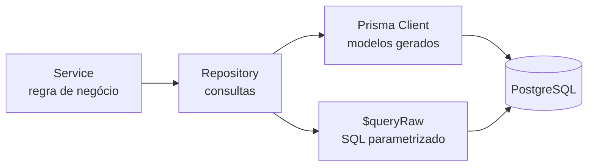

# Mapeamento de Classes e Consultas — Pesquisa de Satisfação FHDOD

**Versão:** 1.0 — 16/10/2026
**Base:** [Modelo de Dados](modelo-de-dados-e-requisitos.md), [Padrões do Banco](padroes-banco-de-dados.md) e [Arquitetura do Backend](arquitetura-backend.md)

Este documento liga o banco ao código. Ele mostra quais classes acessam cada tabela, o que cada repository faz e como são escritas as consultas mais críticas do sistema. Elas são as mais executadas, as que envolvem várias tabelas e as que protegem regras de negócio.

---

## 1. Como o código acessa o banco



Existem dois caminhos até o banco, sempre dentro de um repository:

| Caminho | Quando usar | Exemplos |
| --- | --- | --- |
| **Prisma Client** (métodos como `findMany`, `create`, `update`) | Cadastros e consultas de uma tabela com suas relações | Setores, perguntas, lista de manifestações |
| **`$queryRaw`** (SQL escrito à mão, com parâmetros) | Indicadores com agregações, `FILTER`, junções com a escala ou cálculo por mês | Dashboard, TV Wall, ranking |

O Prisma não gera bem consultas agregadas como o NPS, e SQL escrito à mão para um simples cadastro seria código a mais sem ganho. Os dois caminhos são parametrizados, então ambos protegem contra SQL injection (RNF09).

---

## 2. Classes de modelo (Prisma) ↔ tabelas

O Prisma gera, a partir do `schema.prisma`, uma classe de acesso para cada modelo. Os nomes seguem a seção 3 de `padroes-banco-de-dados.md`.

| Modelo Prisma | Tabela | Acesso no código | Repository responsável |
| --- | --- | --- | --- |
| `Usuario` | `usuario` | `prisma.usuario` | `usuarios.repository` |
| `GestorSetor` | `gestor_setor` | `prisma.gestorSetor` | `usuarios.repository` |
| `LogAuditoria` | `log_auditoria` | `prisma.logAuditoria` | `auditoria.repository` |
| `Setor` | `setor` | `prisma.setor` | `setores.repository` |
| `Turno` | `turno` | `prisma.turno` | `turnos.repository` |
| `Equipe` | `equipe` | `prisma.equipe` | `equipes.repository` |
| `Escala` | `escala` | `prisma.escala` | `escalas.repository` |
| `AtendimentoMensal` | `atendimento_mensal` | `prisma.atendimentoMensal` | `atendimentos.repository` |
| `Etapa` | `etapa` | `prisma.etapa` | `etapas.repository` (cadastro); `perguntas.repository` e `pesquisa.repository` também leem |
| `Pergunta` | `pergunta` | `prisma.pergunta` | `perguntas.repository` |
| `Sessao` | `sessao` | `prisma.sessao` | `pesquisa.repository` |
| `Resposta` | `resposta` | `prisma.resposta` | `pesquisa.repository` |
| `TermoPrivacidade` | `termo_privacidade` | `prisma.termoPrivacidade` | `termos.repository` |
| `Manifestacao` | `manifestacao` | `prisma.manifestacao` | `manifestacoes.repository` |
| `TentativaContato` | `tentativa_contato` | `prisma.tentativaContato` | `manifestacoes.repository` |
| `AnexoManifestacao` | `anexo_manifestacao` | `prisma.anexoManifestacao` | `manifestacoes.repository` |

Os módulos `indicadores` e `tvwall` não têm tabela própria. Seus repositories só **leem** as tabelas de pesquisa e Ouvidoria com consultas agregadas (seção 4). O TV Wall também lê as marcações `exibir_tv_wall` de `setor` e `etapa` (D17 do modelo).

---

## 3. Repositories

Cada repository expõe funções com nomes de negócio. O service chama `pesquisaRepository.gravarNota(...)`, e não `prisma.sessao.updateMany(...)`, então quem lê o service entende o que acontece sem conhecer o Prisma.

| Repository | Principais funções | Tabelas | Operações |
| --- | --- | --- | --- |
| `auth` | `buscarPorEmail`, `buscarAtivoPorId` | Leitura de `usuario` e `gestor_setor` | Só leitura. É o único repository que lê `senha_hash` (login); `buscarAtivoPorId` é usado pelo middleware `autenticar` a cada requisição |
| `usuarios` | `listar`, `criar`, `atualizar`, `definirSetores`, `listarSetoresDoGestor` | `usuario`, `gestor_setor` | Leitura e escrita; `definirSetores` substitui as atribuições numa transação |
| `auditoria` | `registrar` | `log_auditoria` | Só inserção |
| `setores` | `listar`, `buscarPorId`, `buscarPorSlug`, `criar`, `atualizar` | `setor` | Leitura e escrita, sem exclusão |
| `etapas` | `listarDoSetor`, `buscarPorId`, `criar`, `atualizar`, `reordenar` | `etapa` | Leitura e escrita, sem exclusão; `reordenar` grava em duas fases numa transação, porque `ordem` é única dentro do setor |
| `turnos` | `listarAtivos`, `salvarGrade` | `turno` | `salvarGrade` cria, altera e desativa numa transação |
| `equipes` | `listarDoSetor`, `listarAtivasDosSetores`, `criar`, `atualizar` | `equipe` | Leitura e escrita, sem exclusão; nome repetido é recusado pelo banco (D16) e traduzido em `409` |
| `escalas` | `listarDoMes`, `substituirMes` | `escala` | Importação em transação (consulta 4.9) |
| `atendimentos` | `listarDoMes`, `salvar` | `atendimento_mensal` | `upsert` por setor e mês |
| `perguntas` | `listarDoSetor`, `criar`, `atualizar`, `reordenar` | `pergunta`, `etapa` | Leitura e escrita, sem exclusão; o setor da pergunta é o da etapa |
| `pesquisa` | `abrirSessao`, `buscarSessao`, `informarAtendimento`, `gravarResposta`, `gravarNota` | `sessao`, `resposta` | Só inserção, mais a gravação única da data informada e da nota |
| `termos` | `buscarVigente`, `listar`, `criarVersao` | `termo_privacidade` | Só inserção (cada versão é nova) |
| `manifestacoes` | `criar`, `listar`, `buscarDetalhe`, `listarAlertas`, `existeDuplicata`, `classificar`, `registrarTentativa`, `finalizar`, `anexarFoto`, `buscarFoto` | `manifestacao`, `tentativa_contato`, `anexo_manifestacao` | Leitura e escrita, sem exclusão |
| `indicadores` | `resumo`, `distribuicaoNotas`, `evolucao`, `porSetor`, `porEtapa`, `porEquipe`, `adesao`, `dadosExportacao` | Leitura de `sessao`, `resposta`, `pergunta`, `etapa`, `escala`, `equipe`, `atendimento_mensal`, `manifestacao` | Só leitura |
| `tvwall` | `resumoDoMes`, `evolucaoSeisMeses`, `setoresMarcados`, `etapasMarcadas` | Leitura de `sessao`, `resposta`, `pergunta`, `etapa`, `setor`, `atendimento_mensal` | Só leitura; devolve só porcentagens |

**Funções puras usadas pelos services** (em `src/utils/`, sem acesso ao banco e cobertas por testes unitários):

| Função | O que faz |
| --- | --- |
| `turnos.classificar(momento, turnosAtivos)` | Devolve o turno e a data de referência de um momento (D13) |
| `horasUteis.entre(inicio, fim)` | Conta as horas de segunda a sexta entre dois momentos (RF16) |
| `telefone.normalizar(texto)` | Deixa só os dígitos, com DDI e DDD |
| `cripto.cifrar(texto)` / `cripto.decifrar(valor)` | AES-256-GCM com prefixo de versão da chave |
| `cripto.hmac(texto)` | Hash HMAC-SHA256 do telefone |
| `nomes.chaveDeNome(nome)` | Chave para comparar nomes em memória com a mesma regra da *collation* do banco: sem maiúsculas, acentos e espaços nas pontas (RN13, D16) |

---

## 4. Consultas críticas

Nas consultas abaixo, `$1`, `$2` etc. são os parâmetros. No código, eles são passados pelo *template literal* do `$queryRaw` (seção 6 de `padroes-banco-de-dados.md`) e nunca concatenados ao SQL.

Os filtros opcionais do dashboard (turno, etapa, canal) são acrescentados com fragmentos `Prisma.sql`, que continuam parametrizados:

```js
const { Prisma } = require('@prisma/client');

const filtroTurno = turnoId ? Prisma.sql`AND s.turno_id = ${turnoId}` : Prisma.empty;
const filtroCanal = canal ? Prisma.sql`AND s.canal = ${canal}::canal_resposta` : Prisma.empty;

await prisma.$queryRaw`
  SELECT COUNT(*) FROM sessao s
  WHERE s.data_atendimento BETWEEN ${inicio} AND ${fim}
    AND s.setor_id = ANY(${setorIds})
    ${filtroTurno}
    ${filtroCanal}`;
```

O parâmetro `setorIds` sempre vem do service: para o Super Admin, os setores filtrados (ou todos); para o Gestor, apenas os atribuídos a ele (RNF10). Nenhuma consulta de indicador roda sem esse filtro.

### 4.1 Abrir a sessão e classificar o turno (RF02, RN03, D2, D13)

O turno é calculado em JavaScript, a partir da grade de turnos ativos, e gravado na sessão. Isso garante que toda sessão já nasça com setor, data e turno.

```js
// utils/turnos.js: hora local no fuso America/Sao_Paulo, em minutos desde 0h
function classificar(momento, turnos) {
  const { data, minutos } = horaLocal(momento);
  for (const turno of turnos) {
    const inicio = paraMinutos(turno.horaInicio);
    const fim = paraMinutos(turno.horaFim);
    if (inicio < fim && minutos >= inicio && minutos < fim) {
      return { turnoId: turno.id, dataAtendimento: data };
    }
    if (inicio > fim) {                       // atravessa a meia-noite
      if (minutos >= inicio) return { turnoId: turno.id, dataAtendimento: data };
      if (minutos < fim) return { turnoId: turno.id, dataAtendimento: diaAnterior(data) };
    }
  }
  throw new Error('A grade de turnos não cobre este horário');
}
```

```js
// pesquisa.repository.js
prisma.sessao.create({
  data: { setorId, canal, turnoId, dataAtendimento, turnoOrigem: 'CALCULADO' },
  select: { id: true },
});
```

### 4.2 Gravar uma resposta (RF07, RF13, D5)

```js
prisma.resposta.create({
  data: { sessaoId, perguntaId, pulada, valorNumero }, // valorNumero: rostinho de 1 a 5, ou null se pulada
});
```

A restrição única (`sessao_id`, `pergunta_id`) recusa a segunda gravação da mesma pergunta. O Prisma lança o erro `P2002`, que o service converte em `409 Conflict`.

A data e o período informados pela tela do celular (RN03, D2) não são uma resposta: vão direto para a sessão, uma única vez, com a condição dentro do próprio comando, como na nota (4.3):

```js
const { count } = await prisma.sessao.updateMany({
  where: { id: sessaoId, canal: 'CELULAR', turnoOrigem: 'CALCULADO', iniciadaEm: { gt: limite12Horas } },
  data: { dataAtendimento, turnoId, turnoOrigem: 'INFORMADO' },
});
// count === 0: o service verifica se a sessão não existe (404), é de tablet (422) ou já foi informada ou expirou (409)
```

### 4.3 Gravar a nota geral uma única vez (RF03, RN01)

A condição "ainda sem nota e aberta há menos de 12 horas" fica **dentro** do próprio `UPDATE`. Assim, dois envios simultâneos não conseguem gravar duas notas, porque só um deles encontra a linha com `nota_geral` vazia.

```sql
UPDATE sessao
SET nota_geral = $2,
    concluida_em = now()
WHERE id = $1
  AND nota_geral IS NULL
  AND iniciada_em > now() - INTERVAL '12 hours';
```

```js
const { count } = await prisma.sessao.updateMany({
  where: { id: sessaoId, notaGeral: null, iniciadaEm: { gt: limite12Horas } },
  data: { notaGeral: nota, concluidaEm: new Date() },
});
// count === 0: o service verifica se a sessão não existe (404) ou se já tem nota ou expirou (409)
```

### 4.4 Resumo do dashboard (RF27)

Uma única consulta calcula os principais números do painel:

```sql
SELECT
  COUNT(*) FILTER (
    WHERE s.nota_geral IS NOT NULL
       OR EXISTS (SELECT 1 FROM resposta r WHERE r.sessao_id = s.id AND NOT r.pulada)
  )                                                   AS total_respostas,
  COUNT(s.nota_geral)                                 AS respostas_completas,
  ROUND(AVG(s.nota_geral), 1)                         AS nota_media,
  ROUND(
    100.0 * (COUNT(*) FILTER (WHERE s.nota_geral >= 9)
           - COUNT(*) FILTER (WHERE s.nota_geral <= 6))
    / NULLIF(COUNT(s.nota_geral), 0)
  )                                                   AS nps
FROM sessao s
WHERE s.data_atendimento BETWEEN $1 AND $2
  AND s.setor_id = ANY($3);
```

- `total_respostas` conta toda sessão com pelo menos uma resposta válida, concluída ou não (seção 7.1 do modelo).
- `COUNT(s.nota_geral)` conta apenas os valores preenchidos, ou seja, as respostas completas.
- O `NULLIF` evita divisão por zero: sem notas no período, o NPS fica vazio em vez de causar erro.
- O `EXISTS` usa o índice da restrição única de `resposta`, que começa por `sessao_id`.

Distribuição das notas (gráfico de 0 a 10):

```sql
SELECT s.nota_geral AS nota,
       COUNT(*) AS quantidade
FROM sessao s
WHERE s.nota_geral IS NOT NULL
  AND s.data_atendimento BETWEEN $1 AND $2
  AND s.setor_id = ANY($3)
GROUP BY s.nota_geral
ORDER BY s.nota_geral;
```

Notas sem nenhuma resposta não aparecem no resultado; o service completa a lista de 0 a 10 com zeros.

### 4.5 Taxa de adesão por setor (RF25, RF27)

```sql
SELECT st.nome            AS setor,
       am.quantidade      AS atendimentos,
       COUNT(s.id)        AS respostas_completas,
       ROUND(100.0 * COUNT(s.id) / am.quantidade, 1) AS taxa_adesao
FROM setor st
LEFT JOIN atendimento_mensal am
       ON am.setor_id = st.id
      AND am.competencia = $1
LEFT JOIN sessao s
       ON s.setor_id = st.id
      AND s.nota_geral IS NOT NULL
      AND s.data_atendimento >= $1
      AND s.data_atendimento < $1::date + INTERVAL '1 month'
WHERE st.id = ANY($2)
GROUP BY st.id, st.nome, am.quantidade
ORDER BY st.nome;
```

Os dois `LEFT JOIN` garantem que todo setor apareça, mesmo sem respostas ou sem atendimentos informados. Quando não há atendimentos informados, `am.quantidade` é nulo, a divisão resulta em nulo, e o painel mostra "atendimentos não informados" (RF27).

### 4.6 Avaliação por etapa (RF28, RN01)

```sql
SELECT st.nome                        AS setor,
       e.nome                         AS etapa,
       COUNT(*)                       AS avaliacoes,
       ROUND(AVG(r.valor_numero), 2)  AS media,
       ROUND(100.0 * COUNT(*) FILTER (WHERE r.valor_numero >= $4) / COUNT(*)) AS indice
FROM resposta r
JOIN pergunta p ON p.id = r.pergunta_id
JOIN etapa e    ON e.id = p.etapa_id
JOIN setor st   ON st.id = e.setor_id
JOIN sessao s   ON s.id = r.sessao_id
WHERE NOT r.pulada
  AND s.data_atendimento BETWEEN $1 AND $2
  AND e.setor_id = ANY($3)
GROUP BY st.nome, e.id, e.nome, e.ordem
ORDER BY st.nome, e.ordem;
```

A consulta não exige `nota_geral`: respostas de pesquisas não concluídas também entram (RN01). Toda pergunta é um rostinho (D4), então todas as etapas são comparadas na mesma escala de 1 a 5. `$4` é `REGRAS.ROSTINHO_POSITIVO_MINIMO` (4): o índice de satisfação é a porcentagem de rostinhos 4 e 5 (seção 7.1 do modelo).

### 4.7 Nota por equipe (RF28, RN04, D3)

```sql
SELECT eq.nome                    AS equipe,
       COUNT(*)                   AS respostas,
       ROUND(AVG(s.nota_geral), 1) AS nota_media
FROM sessao s
JOIN escala es ON es.setor_id = s.setor_id
              AND es.data = s.data_atendimento
              AND es.turno_id = s.turno_id
JOIN equipe eq ON eq.id = es.equipe_id
WHERE s.nota_geral IS NOT NULL
  AND s.setor_id = $1
  AND s.data_atendimento BETWEEN $2 AND $3
GROUP BY eq.id, eq.nome
ORDER BY nota_media DESC;
```

A junção usa a restrição única de `escala` (`setor_id`, `data`, `turno_id`) como índice. Sessões de dias sem escala importada simplesmente não aparecem neste painel, mas continuam nos demais.

### 4.8 Fila da Ouvidoria e alerta de 48 horas (RF14, RF16)

A lista com filtros usa o Prisma Client, com paginação:

```js
prisma.manifestacao.findMany({
  where: { status, tipo, setorId, turnoId, dataOcorrencia: { gte: inicio, lte: fim } },
  select: {
    id: true, tipo: true, origem: true, status: true, dataOcorrencia: true,
    pediuRetorno: true, possivelDuplicata: true,
    setor: { select: { nome: true } },
    etapa: { select: { nome: true } },
    turno: { select: { nome: true } },
    sessao: { select: { notaGeral: true } },
    _count: { select: { tentativas: true } },
  },
  orderBy: { criadoEm: 'desc' },
  skip: (pagina - 1) * tamanho,
  take: tamanho,
});
```

O filtro "a classificar" (RF14, RN12) é enviado ao Prisma como `tipo: null`, que vira `tipo IS NULL`. Sem filtro de tipo, o service passa `tipo: undefined`, que o Prisma ignora. Confundir os dois muda o resultado: `null` traz só as não classificadas, e `undefined` traz todas.

O `select` lista os campos explicitamente e **não inclui** `texto`, `telefoneCifrado`, `telefoneHash` nem `profissionalCitado`. Esses campos só são lidos na consulta de detalhe de um chamado (RF14, RNF10). O filtro por protocolo usa o próprio `id`.

Para o alerta, o banco devolve os candidatos e o service calcula as horas úteis com `horasUteis.entre`, que não depende de feriados nem de fuso no SQL:

```sql
SELECT m.id, m.criado_em
FROM manifestacao m
WHERE m.pediu_retorno
  AND m.status = 'NOVA'
ORDER BY m.criado_em;
```

O status `NOVA` já indica que não houve nenhuma tentativa de contato, porque a primeira tentativa muda o status para `EM_CONTATO`.

### 4.9 Importação da escala (RF21)

Primeiro, o service valida a planilha inteira contra as equipes cadastradas, sem gravar nada:

```js
// Mesma regra da collation das colunas de nome: sem maiúsculas, acentos e espaços nas pontas (D16)
const chave = (setorId, nome) => `${setorId}:${chaveDeNome(nome)}`;

const ativas = await equipesRepository.listarAtivasDosSetores(setoresDaPlanilha);
const equipes = new Map(ativas.map((e) => [chave(e.setorId, e.nome), e.id]));

const erros = linhas
  .filter((l) => !equipes.has(chave(l.setorId, l.equipe)))
  .map((l) => ({ linha: l.numero, mensagem: `Equipe "${l.equipe}" não cadastrada ou inativa neste setor` }));

if (erros.length > 0) throw new AppError(422, 'ESCALA_COM_ERROS', 'A planilha tem linhas a corrigir.', erros);
```

Com todas as linhas válidas, uma única transação substitui a escala do mês:

```js
await prisma.$transaction(async (tx) => {
  await tx.escala.deleteMany({
    where: { setorId: { in: setoresDaPlanilha }, data: { gte: inicioDoMes, lt: inicioDoMesSeguinte } },
  });
  await tx.escala.createMany({
    data: linhas.map((l) => ({
      setorId: l.setorId, data: l.data, turnoId: l.turnoId,
      equipeId: equipes.get(chave(l.setorId, l.equipe)), importadaPorId: usuarioId,
    })),
  });
});
```

A importação nunca cadastra equipes: um nome desconhecido é sempre um erro a corrigir, e não uma equipe nova (seção 5.3 do modelo). Se uma linha tiver erro, nada é gravado. Se a gravação falhar no meio, a escala anterior do mês continua intacta.

### 4.10 Possível duplicata (RF19)

```sql
SELECT EXISTS (
  SELECT 1
  FROM manifestacao m
  WHERE m.telefone_hash = $1
    AND m.setor_id = $2
    AND m.criado_em >= now() - INTERVAL '24 hours'
) AS possivel_duplicata;
```

Atendida pelo índice `manifestacao (telefone_hash, setor_id)`. O resultado só marca o aviso `possivel_duplicata`; a manifestação é gravada de qualquer forma (RF19).

### 4.11 Finalização do chamado (RF15, RN07, RNF11)

```js
await prisma.$transaction(async (tx) => {
  if (status === 'SEM_RETORNO') {
    const falhas = await tx.tentativaContato.count({
      where: { manifestacaoId: id, resultado: 'SEM_SUCESSO' },
    });
    if (falhas < 3) throw new AppError(422, 'CHAMADO_SEM_TENTATIVAS_SUFICIENTES', '...');
  }

  const { count } = await tx.manifestacao.updateMany({
    where: { id, status: { in: ['NOVA', 'EM_CONTATO'] } },
    data: {
      status, desfecho, finalizadaEm: new Date(),
      telefoneCifrado: null, telefoneHash: null,
    },
  });
  if (count === 0) throw new AppError(409, 'CHAMADO_JA_FINALIZADO', '...');

  await tx.logAuditoria.create({
    data: {
      usuarioId, acao: 'ANONIMIZACAO', entidade: 'manifestacao', entidadeId: String(id),
      dadosNovos: { status, desfecho },
    },
  });
});
```

O telefone é apagado no mesmo comando que finaliza o chamado, e o banco recusaria a finalização sem isso (restrição `ck_manifestacao_finalizacao`). O log não recebe o telefone (seção 5.2 do modelo).

### 4.12 Painéis do TV Wall (RF30, RN08)

O TV Wall só devolve **porcentagens** (RN08, D17). Índice de satisfação do mês corrente, para o hospital inteiro:

```sql
SELECT
  COUNT(*)                                                                   AS avaliacoes,
  ROUND(100.0 * COUNT(*) FILTER (WHERE s.nota_geral >= $2) / NULLIF(COUNT(*), 0)) AS indice
FROM sessao s
WHERE s.nota_geral IS NOT NULL
  AND s.data_atendimento >= date_trunc('month', $1::date)
  AND s.data_atendimento <  date_trunc('month', $1::date) + INTERVAL '1 month';
```

`$2` é `REGRAS.NOTA_POSITIVA_MINIMA` (7). A contagem de avaliações só serve para o service conferir o mínimo (`TV_WALL_MINIMO_RESPOSTAS`) e **não vai para a resposta da API**. A taxa de adesão do mês é calculada como na consulta 4.5, só com os setores que têm atendimentos informados.

Evolução do índice nos últimos 6 meses:

```sql
SELECT date_trunc('month', s.data_atendimento)::date AS mes,
       COUNT(*)                                      AS avaliacoes,
       ROUND(100.0 * COUNT(*) FILTER (WHERE s.nota_geral >= $2) / COUNT(*)) AS indice
FROM sessao s
WHERE s.nota_geral IS NOT NULL
  AND s.data_atendimento >= date_trunc('month', $1::date) - INTERVAL '5 months'
  AND s.data_atendimento <  date_trunc('month', $1::date) + INTERVAL '1 month'
GROUP BY 1
ORDER BY 1;
```

`$1` é a data de hoje no fuso `America/Sao_Paulo`. Meses sem respostas não aparecem no resultado, e o service os completa como vazios, para o gráfico sempre mostrar 6 meses.

Setores marcados (RF31): o mesmo índice da nota geral, agrupado por setor, só para `setor.ativo AND setor.exibir_tv_wall`, e só com os grupos que tenham pelo menos `TV_WALL_MINIMO_RESPOSTAS` avaliações no mês (`HAVING COUNT(*) >= $3`). Etapas marcadas: o índice dos rostinhos da consulta 4.6, só para `etapa.ativo AND etapa.exibir_tv_wall` de setor ativo, com o mesmo `HAVING`.

Nenhuma consulta do TV Wall devolve contagens, turno, equipe, manifestações, nomes de pessoas ou telefones (RN08). Os resultados passam pelo cache por versão (seção 8 da arquitetura).

---

## 5. Uso dos índices

| Consulta | Índice usado |
| --- | --- |
| 4.4, 4.5, 4.6, 4.12 — indicadores por período e setor | `sessao (setor_id, data_atendimento)` e `sessao (data_atendimento)` |
| 4.4, 4.12 — `EXISTS` de resposta válida | Restrição única `resposta (sessao_id, pergunta_id)` |
| 4.6 — respostas por pergunta | `resposta (pergunta_id)` |
| 4.7 — cruzamento com a escala | Restrição única `escala (setor_id, data, turno_id)` |
| 4.8 — fila e alerta | `manifestacao (status, criado_em)` e `manifestacao (setor_id, data_ocorrencia)` |
| 4.10 — duplicata | `manifestacao (telefone_hash, setor_id)` |

Depois da publicação, consultas lentas são investigadas com `EXPLAIN ANALYZE` no painel do Neon, e um novo índice entra por migração (seção 4 de `padroes-banco-de-dados.md`).
