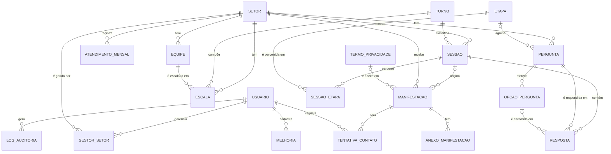

# Modelo de Dados e Requisitos — Pesquisa de Satisfação FHDOD

**Versão:** 1.0 — 16/10/2026
**Base:** [Documento de Requisitos](Documento_de_Requisitos_FHDOD.md), versão 1.11

Este documento define como os dados do sistema são organizados no banco: a escolha do tipo de banco, as entidades e seus relacionamentos, o dicionário de dados, as regras de integridade e a ligação de cada tabela aos requisitos. Ele é a base do `schema.prisma`, dos scripts de criação e povoamento e da camada de repositórios do backend.

---

## 1. Escolha do banco: relacional (SQL) ou não relacional (NoSQL)

O sistema usa um banco **relacional**, o PostgreSQL. A escolha foi feita comparando o que o sistema precisa com o que cada modelo oferece:

| Necessidade do sistema | Relacional (PostgreSQL) | Não relacional (ex.: MongoDB) |
| --- | --- | --- |
| **Muitos relacionamentos.** Resposta → sessão → setor; sessão → escala → equipe; gestor ↔ setor (N:N, RN10). | Chaves estrangeiras e *joins* são o centro do modelo. | Exige duplicar dados nos documentos ou fazer as junções na aplicação. |
| **Integridade garantida.** Respostas nunca apagadas (RN01), perguntas nunca removidas (RN09), chamado só finaliza com desfecho (RN07). | Chaves estrangeiras com `RESTRICT` e restrições `CHECK` garantem as regras no próprio banco, mesmo se a aplicação errar. | As regras ficam só no código da aplicação. |
| **Indicadores agregados.** Nota média, NPS e ranking por setor, turno, equipe e etapa (RF27, RF28). | `GROUP BY`, `FILTER` e *joins* resolvem cada indicador em uma consulta. | Exige *pipelines* de agregação mais complexos para cruzar coleções. |
| **Operações que não podem ficar pela metade.** Finalizar um chamado, apagar o telefone e registrar o log (RN07, RNF11). | Transações ACID: ou tudo acontece, ou nada acontece. | Suporte a transações existe, mas não é o uso natural do modelo. |
| **Estrutura conhecida e estável.** As entidades vêm direto dos requisitos. | O esquema fixo documenta o sistema e é validado pelo banco. | A flexibilidade de esquema não traz ganho aqui. |
| **Restrição do projeto.** RNF01 define Prisma e PostgreSQL; RNF02 define o Neon. | Atende diretamente. | Exigiria mudar a especificação. |

Um banco NoSQL seria a melhor escolha para dados sem estrutura fixa, volume de escrita muito alto ou documentos lidos sempre inteiros, e nenhum desses é o caso aqui. O único ponto com estrutura variável, o registro de auditoria (RNF11), é resolvido dentro do próprio PostgreSQL com colunas `JSONB`.

Entre os bancos relacionais, o **PostgreSQL** foi escolhido por oferecer:

- tipos enumerados (`ENUM`), restrições `CHECK`, `UUID` e `TIMESTAMPTZ` nativos;
- `JSONB` para o log de auditoria;
- a cláusula `FILTER`, que simplifica o cálculo do NPS;
- hospedagem gerenciada e gratuita no Neon, com backup automático (RNF02);
- suporte completo no Prisma (RNF01).

---

## 2. Convenções adotadas

As convenções serão detalhadas em `padroes-banco-de-dados.md`. As principais, já aplicadas aqui:

- Nomes em português, sem acentos, em `snake_case`.
- Tabelas no **singular** (`setor`, `sessao`), porque os plurais em português são irregulares (`opcoes`, `sessoes`) e o singular coincide com o nome dos modelos no Prisma.
- Chave primária `id`; chave estrangeira `<tabela>_id` (ex.: `setor_id`).
- Datas e horas com sufixo `_em` (`criado_em`); booleanos como adjetivo (`ativo`, `pulada`).
- Valores de `ENUM` em maiúsculas (`SUPER_ADMIN`).
- Nomes cadastrados pelo Super Admin (setor, turno, etapa e equipe) usam a collation `ignora_maiusculas_e_acentos`, que compara sem diferenciar maiúsculas nem acentos (D16).
- Momentos (data com hora) sempre em `TIMESTAMPTZ`, gravados em UTC e convertidos para o fuso `America/Sao_Paulo` ao calcular datas e turnos. Datas sem hora usam `DATE`, e horários de turno, `TIME`.

---

## 3. Visão geral

O modelo tem **19 tabelas**, organizadas em quatro grupos:

| Grupo | Tabelas | Requisitos principais |
| --- | --- | --- |
| Acesso | `usuario`, `gestor_setor`, `log_auditoria` | RF20, RF26, RN10, RNF10, RNF11 |
| Estrutura do hospital | `setor`, `turno`, `equipe`, `escala`, `atendimento_mensal` | RF20, RF21, RF25, RN04 |
| Pesquisa | `etapa`, `pergunta`, `opcao_pergunta`, `sessao`, `sessao_etapa`, `resposta` | RF01–RF13, RF22, RF23, RN01–RN03 |
| Ouvidoria e TV Wall | `manifestacao`, `tentativa_contato`, `anexo_manifestacao`, `termo_privacidade`, `melhoria` | RF09, RF10, RF14–RF19, RF24, RN05–RN08 |

### 3.1 Diagrama entidade-relacionamento

Para manter o diagrama legível, ele omite as chaves estrangeiras que só registram quem fez a ação (`informado_por_id`, `criado_por_id` etc.). Elas aparecem no dicionário de dados.



Leitura dos símbolos: `||` = exatamente um; `|o` = zero ou um; `o{` = zero ou muitos. Assim, `SETOR ||--o{ SESSAO` significa que cada sessão pertence a exatamente um setor, e um setor pode ter zero ou muitas sessões.

---

## 4. Decisões de modelagem

As decisões abaixo explicam as escolhas menos óbvias do modelo e o requisito que motivou cada uma.

**D1 — A nota geral fica na sessão, não na tabela de respostas.**
A nota de 0 a 10 é a única pergunta obrigatória, é a mesma em todos os setores e existe uma vez por sessão (RF03). Como coluna `sessao.nota_geral`, ela não precisa ser cadastrada como pergunta e não pode ser desativada por engano. Além disso, "resposta completa" (definição da taxa de adesão) passa a ser simplesmente `nota_geral IS NOT NULL`, e o NPS sai de uma única tabela.

**D2 — Data e turno são resolvidos e gravados na sessão.**
O objetivo 1.2 é registrar setor, data e turno em **100%** das respostas. A sessão nasce com a data e o turno calculados pela hora de abertura (`turno_origem = CALCULADO`). Se o paciente responder a pergunta de data e período, os valores são substituídos pelos informados (`INFORMADO`), como define a RN03. Assim, toda sessão sempre tem os três dados, e os filtros do dashboard não precisam saber de onde veio o turno.

**D3 — A equipe é encontrada pela escala, não gravada na resposta.**
A equipe de uma sessão é obtida cruzando setor, data e turno da sessão com a tabela `escala` (RN04). A escala costuma ser importada depois do início do mês (RF21). Se a equipe fosse gravada no momento da resposta, as respostas anteriores à importação ficariam sem equipe. Com o cruzamento, importar ou corrigir a escala atualiza os indicadores automaticamente.

**D4 — Respostas usam colunas tipadas.**
Cada tipo de pergunta (RF22) grava em uma coluna própria: `valor_numero` (rostinhos e escala), `valor_booleano` (sim/não), `opcao_id` (múltipla escolha) e `valor_data` com `turno_id` (data e período). As alternativas seriam guardar tudo como texto ou em `JSON`, mas assim o banco valida os valores e as médias são calculadas direto em SQL, sem conversões.

**D5 — Perguntas puladas também são gravadas.**
Pular uma pergunta (RF03) grava uma resposta com `pulada = true` e sem valor. Isso mostra quais perguntas os pacientes evitam e permite retomar a sessão no ponto exato em que parou (RF13). As médias (`AVG`) ignoram essas linhas automaticamente, porque desconsideram valores nulos; as contagens de respostas filtram `pulada = false`.

**D6 — Nada que tenha histórico é apagado.**
Setores, turnos, etapas, equipes, usuários, perguntas e opções são **desativados** (`ativo = false`), nunca removidos (RF20, RF23, RN09). As chaves estrangeiras usam `ON DELETE RESTRICT`, então o banco recusa qualquer exclusão que deixaria uma resposta ou manifestação órfã (RN01, RN07). "Descartar" uma sessão no tablet (RF13) significa não continuá-la: as respostas já dadas permanecem e contam nos indicadores das etapas (RF07).

Só há dois casos de exclusão física, ambos em tabelas de configuração que nenhuma resposta referencia por chave estrangeira: retirar um setor de um gestor (`gestor_setor`) e substituir linhas da escala ao importar de novo um mês (`escala`).

**D7 — O telefone é cifrado, tem um hash separado e é apagado ao finalizar.**
O número é normalizado (apenas dígitos, com DDI e DDD) e então gravado de duas formas:

- `telefone_cifrado`: o número criptografado com AES-256-GCM, reversível só para o Super Admin ligar de volta (RNF10).
- `telefone_hash`: um HMAC-SHA256, irreversível, usado apenas para detectar duplicatas (RF19).

As duas chaves ficam em variáveis de ambiente, fora do banco, e o texto cifrado começa com a versão da chave usada (ex.: `v1:`), o que permite trocar a chave no futuro sem perder os números já gravados (detalhes em `seguranca-e-nuvem.md`). Ao finalizar o chamado, as duas colunas são apagadas (RN07, RNF12), mas a coluna `pediu_retorno` continua registrando que houve pedido de retorno, para os indicadores da Ouvidoria. A normalização antes do hash garante que "(51) 99999-9999" e "51999999999" sejam reconhecidos como o mesmo número.

**D8 — Os termos de privacidade são versionados.**
Cada alteração do texto (RF24) cria uma nova versão em vez de sobrescrever a anterior. A manifestação guarda **qual versão** o paciente aceitou e quando (RN06). É a forma de comprovar, pela LGPD, exatamente com o que o titular concordou.

**D9 — O texto do elogio no TV Wall é separado do original.**
O texto original da manifestação nunca é alterado. Ao aprovar um elogio (RF18), o Super Admin grava em `texto_tv_wall` a versão que será exibida, podendo retirar nomes (RN08).

**D10 — A sessão usa UUID como chave.**
O código da sessão circula nas rotas públicas da pesquisa (RNF08). Um número sequencial permitiria adivinhar a sessão de outro paciente (1, 2, 3...); um UUID aleatório não. As demais tabelas, acessíveis só com login, usam números inteiros, mais compactos e legíveis.

**D11 — A sessão não guarda nenhum dado pessoal.**
Não há IP, identificador de aparelho ou navegador na sessão (RNF12, coleta mínima). O aviso "Você já respondeu hoje" (RF13) é resolvido no próprio navegador: o frontend guarda o código da última sessão por setor no `localStorage` e consulta se ela tem menos de 12 horas. Como o RF13 prevê, isso vale só no celular. No tablet, que é compartilhado, o aviso apareceria para o próximo paciente, então a sessão não é guardada. Isso não contraria o RNF07, porque nenhuma resposta é guardada localmente, só o código.

**D12 — Profissionais não são cadastrados.**
O sistema avalia equipes, não pessoas (RN04). A equipe é o grupo de plantão em um setor e turno (definição 1.3 dos requisitos), não a categoria profissional: "Enfermagem" é uma **etapa** da jornada, avaliada pelas perguntas daquela etapa, enquanto a equipe responde à pergunta "quem estava de plantão?". Ela é cadastrada pelo Super Admin (RF20), tem só um nome (ex.: "Equipe A") e pertence a um setor, porque o dashboard chega à equipe sempre a partir do setor (RF28) e porque a "Equipe A" do Pronto Atendimento e a "Equipe A" da Internação podem ser pessoas diferentes. Um profissional citado pelo paciente fica em uma coluna própria da manifestação (`profissional_citado`). Separado do texto livre, esse dado é fácil de excluir de indicadores, exportações e do TV Wall (RF28, RN08).

**D13 — Turnos que atravessam a meia-noite pertencem à data em que começaram.**
Os turnos são cadastrados e alterados pelo Super Admin (RF20), então o modelo não conhece "o turno da noite": ele trata de forma genérica qualquer turno com `hora_inicio > hora_fim`, que é o sinal de que o turno atravessa a meia-noite.

Exemplo com um turno cadastrado das 19h às 7h: a pessoa atendida às 2h do dia 15 está no plantão que **começou às 19h do dia 14**. A sessão recebe esse turno e `data_atendimento = 14`. Se recebesse a data 15, o cruzamento com a escala (D3) encontraria a equipe do plantão que só começa às 19h do dia 15, ou seja, a equipe errada. A mesma convenção vale para a planilha da escala: cada linha usa a data de início do turno.

Como os turnos mudam com o tempo, a sessão guarda o **turno** (`turno_id`), e não o horário. Alterar o horário de um turno vale só para as sessões novas; as antigas continuam classificadas no turno em que foram registradas.

**D14 — O tipo da manifestação da pesquisa começa vazio.**
Quem classifica a manifestação é a Ouvidoria, não o paciente (RN12): o paciente tende a escolher o tipo pelo sentimento, e uma "sugestão" pode ser uma reclamação grave. Por isso `manifestacao.tipo` aceita vazio, e vazio significa "a classificar". A alternativa seria um valor `NAO_CLASSIFICADA` no tipo enumerado, mas isso misturaria "ainda não se sabe" com os tipos de verdade e exigiria excluí-lo de toda contagem por tipo. Duas restrições `CHECK` garantem a regra: só a origem `PESQUISA` chega sem tipo, e nenhum chamado é finalizado sem tipo. Assim, os indicadores por tipo (RF27) só ficam com a categoria "a classificar" enquanto o chamado está aberto.

**D15 — As etapas da jornada são cadastradas pelo Super Admin.**
As quatro etapas iniciais (Recepção, Triagem, Enfermagem e Médico) vêm do povoamento, mas o Super Admin pode criar, renomear, reordenar e desativar etapas (RF06, RF20). Assim, uma etapa nova, como Farmácia ou Laboratório, não exige mudança de código nem de banco. Como as demais tabelas com histórico (D6), a etapa nunca é apagada: `ativo = false` a retira da pesquisa, e as respostas e manifestações antigas continuam ligadas a ela nos indicadores. A pesquisa só oferece ao paciente as etapas ativas com pelo menos uma pergunta ativa no setor, para que ele nunca escolha uma etapa sem perguntas; essa regra depende da tabela `pergunta` e por isso fica no serviço da pesquisa. Pela mesma razão, uma pergunta não pode ser criada nem reativada em etapa desativada (RF22). O povoamento só cria as etapas iniciais quando a tabela está vazia: depois disso elas são do Super Admin, e recriar "Triagem" depois de uma renomeação violaria a restrição única de `ordem`.

**D16 — Nomes cadastrados não diferenciam maiúsculas nem acentos.**
Os nomes de setor, turno, etapa e equipe são digitados por pessoas e conferidos contra planilhas (RF21). Se "Recepção" e "RECEPCAO" fossem nomes diferentes, o dashboard mostraria dois setores com as respostas divididas, e a importação da escala não saberia a qual equipe ligar a linha. Por isso as quatro colunas `nome` usam uma *collation* ICU não determinística de nível 1 (`ignora_maiusculas_e_acentos`, locale `und-u-ks-level1`), que compara só as letras-base (RN13). As restrições únicas que já existiam passam a recusar o nome repetido, e uma busca por igualdade encontra o cadastro de qualquer forma que ele seja escrito; o nome continua gravado como foi digitado. Espaços e pontuação continuam contando, para que um erro de digitação como "Equipe  A" (dois espaços) não seja aceito em silêncio.

Alternativas descartadas: verificar na aplicação antes de gravar deixaria passar dois cadastros simultâneos e teria de ser repetido em cada módulo; um índice único sobre `lower(nome)` não é representado pelo Prisma, que tentaria removê-lo; o tipo `citext` ignora maiúsculas, mas não acentos. A *collation* é uma propriedade da coluna: o Prisma não a descreve no `schema.prisma`, mas também não a remove (conferido com `prisma migrate diff`). A limitação é que colunas com essa *collation* não aceitam `LIKE`/`ILIKE` no PostgreSQL 17, então nenhuma consulta faz busca por trecho do nome (no Prisma: `contains`, `startsWith`, `endsWith`).

---

## 5. Dicionário de dados

Convenções das tabelas: **Nulo** indica se a coluna aceita valor vazio; **PK** = chave primária; **FK** = chave estrangeira; **UK** = valor único. Todas as chaves estrangeiras usam `ON DELETE RESTRICT`, salvo indicação em contrário.

### 5.1 Tipos enumerados

| Tipo | Valores | Uso |
| --- | --- | --- |
| `perfil_usuario` | `SUPER_ADMIN`, `GESTOR` | Perfil de acesso (seção 2.1 dos requisitos) |
| `tipo_pergunta` | `ROSTINHO`, `ESCALA`, `SIM_NAO`, `MULTIPLA_ESCOLHA`, `DATA_PERIODO` | Tipos de pergunta (RF22) |
| `canal_resposta` | `CELULAR`, `TABLET` | Canal da sessão (RF02) |
| `origem_turno` | `INFORMADO`, `CALCULADO` | Como o turno da sessão foi obtido (RN03) |
| `tipo_manifestacao` | `ELOGIO`, `RECLAMACAO`, `SUGESTAO` | Tipo da manifestação, definido pela Ouvidoria (RN12, D14) |
| `origem_manifestacao` | `PESQUISA`, `TELEFONE`, `PRESENCIAL`, `EMAIL`, `PAPEL` | Canal da manifestação (RF17) |
| `status_manifestacao` | `NOVA`, `EM_CONTATO`, `ENCERRADA`, `SEM_RETORNO` | Situação do chamado (RF15) |
| `resultado_contato` | `CONTATO_REALIZADO`, `SEM_SUCESSO` | Resultado de cada tentativa (RF15) |
| `acao_auditoria` | `CRIACAO`, `ALTERACAO`, `DESATIVACAO`, `ANONIMIZACAO` | Ação registrada no log (RNF11) |

### 5.2 Acesso

#### `usuario`

Pessoas com login: Ouvidoria (Super Admin) e gestores (RF20, RF26).

| Coluna | Tipo | Nulo | Restrições | Descrição |
| --- | --- | --- | --- | --- |
| `id` | `INTEGER` | Não | PK, autoincremento | Identificador |
| `nome` | `VARCHAR(120)` | Não | | Nome completo |
| `email` | `VARCHAR(254)` | Não | UK; `CHECK (email = lower(email))` | Login; sempre gravado em minúsculas |
| `senha_hash` | `CHAR(60)` | Não | | Senha cifrada com bcrypt (RNF09); nunca a senha em texto |
| `perfil` | `perfil_usuario` | Não | | Super Admin ou Gestor |
| `ativo` | `BOOLEAN` | Não | padrão `true` | Usuário desativado não faz login (RF20) |
| `criado_em` | `TIMESTAMPTZ` | Não | padrão `now()` | Data de cadastro |
| `atualizado_em` | `TIMESTAMPTZ` | Não | atualizado pelo Prisma | Última alteração |

#### `gestor_setor`

Setores atribuídos a cada gestor. A relação é muitos para muitos (RN10).

| Coluna | Tipo | Nulo | Restrições | Descrição |
| --- | --- | --- | --- | --- |
| `usuario_id` | `INTEGER` | Não | PK, FK → `usuario` | Gestor |
| `setor_id` | `INTEGER` | Não | PK, FK → `setor` | Setor atribuído |
| `criado_em` | `TIMESTAMPTZ` | Não | padrão `now()` | Data da atribuição |

A chave primária é composta (`usuario_id`, `setor_id`), o que impede atribuir o mesmo setor duas vezes. Retirar um setor de um gestor apaga a linha, o que é permitido porque nenhuma resposta depende dela (D6). A alteração fica registrada no log.

#### `log_auditoria`

Registro das alterações em manifestações, perguntas e usuários (RNF11).

| Coluna | Tipo | Nulo | Restrições | Descrição |
| --- | --- | --- | --- | --- |
| `id` | `BIGINT` | Não | PK, autoincremento | Identificador |
| `usuario_id` | `INTEGER` | Não | FK → `usuario` | Quem fez a ação |
| `acao` | `acao_auditoria` | Não | | O que foi feito |
| `entidade` | `VARCHAR(40)` | Não | | Tabela afetada (ex.: `pergunta`) |
| `entidade_id` | `VARCHAR(40)` | Não | | Identificador do registro afetado |
| `dados_anteriores` | `JSONB` | Sim | | Estado antes da alteração |
| `dados_novos` | `JSONB` | Sim | | Estado depois da alteração |
| `criado_em` | `TIMESTAMPTZ` | Não | padrão `now()` | Data e hora da ação |

O log **nunca** recebe `telefone_cifrado`, `telefone_hash` ou `senha_hash`: a aplicação remove esses campos antes de gravar. Se não fizesse isso, o log manteria uma cópia do telefone depois que o chamado o apagou (RN07). A anonimização é registrada com a ação `ANONIMIZACAO`, sem o número.

### 5.3 Estrutura do hospital

#### `setor`

Unidade de atendimento com pesquisa própria (RF01, RF20).

| Coluna | Tipo | Nulo | Restrições | Descrição |
| --- | --- | --- | --- | --- |
| `id` | `INTEGER` | Não | PK, autoincremento | Identificador |
| `nome` | `VARCHAR(80)` | Não | UK, sem diferenciar maiúsculas e acentos (D16) | Nome exibido (ex.: "Pronto Atendimento") |
| `slug` | `VARCHAR(80)` | Não | UK; `CHECK (slug ~ '^[a-z0-9]+(-[a-z0-9]+)*$')` | Trecho da URL e do QR Code (ex.: `pronto-atendimento`) |
| `ativo` | `BOOLEAN` | Não | padrão `true` | Setor desativado mostra "pesquisa indisponível" |
| `criado_em` | `TIMESTAMPTZ` | Não | padrão `now()` | Data de cadastro |
| `atualizado_em` | `TIMESTAMPTZ` | Não | atualizado pelo Prisma | Última alteração |

O `slug` não deve ser alterado depois que o QR Code for impresso; a tela de edição avisa sobre isso.

#### `turno`

Período de trabalho com horário de início e fim (RF20).

| Coluna | Tipo | Nulo | Restrições | Descrição |
| --- | --- | --- | --- | --- |
| `id` | `INTEGER` | Não | PK, autoincremento | Identificador |
| `nome` | `VARCHAR(40)` | Não | UK, sem diferenciar maiúsculas e acentos (D16) | Nome exibido (ex.: "Noite (19h–7h)") |
| `hora_inicio` | `TIME` | Não | `CHECK (hora_inicio <> hora_fim)` | Início do turno |
| `hora_fim` | `TIME` | Não | | Fim do turno; menor que o início quando atravessa a meia-noite (D13) |
| `ativo` | `BOOLEAN` | Não | padrão `true` | Turno desativado não aparece em novas escalas |
| `criado_em` | `TIMESTAMPTZ` | Não | padrão `now()` | Data de cadastro |
| `atualizado_em` | `TIMESTAMPTZ` | Não | atualizado pelo Prisma | Última alteração |

Regras da aplicação:

- Os turnos ativos cobrem as 24 horas do dia, sem sobreposição. É isso que garante que toda sessão receba um turno (D2). A regra é verificada sempre que o Super Admin cria, altera ou desativa um turno; uma troca de grade (ex.: de três turnos para dois plantões de 12 horas) é feita cadastrando os novos turnos e desativando os antigos na mesma operação.
- Alterar o horário de um turno afeta só as sessões novas (D13).

#### `equipe`

Grupo de profissionais de plantão em um setor, identificado só pelo nome (RN04, D12).

| Coluna | Tipo | Nulo | Restrições | Descrição |
| --- | --- | --- | --- | --- |
| `id` | `INTEGER` | Não | PK, autoincremento | Identificador |
| `setor_id` | `INTEGER` | Não | FK → `setor` | Setor ao qual a equipe pertence |
| `nome` | `VARCHAR(80)` | Não | Sem diferenciar maiúsculas e acentos (D16) | Nome da equipe (ex.: "Equipe A"), igual ao usado na planilha da escala |
| `ativo` | `BOOLEAN` | Não | padrão `true` | Equipe desativada não é aceita em novas importações, mas continua nos indicadores dos meses em que trabalhou |
| `criado_em` | `TIMESTAMPTZ` | Não | padrão `now()` | Data de cadastro |
| `atualizado_em` | `TIMESTAMPTZ` | Não | atualizado pelo Prisma | Última alteração |

Restrição única (`setor_id`, `nome`), sem diferenciar maiúsculas e acentos (D16): o mesmo nome pode existir em setores diferentes, como equipes distintas.

As equipes são **cadastradas pelo Super Admin** (RF20), e a importação da escala só aceita equipes cadastradas e ativas no setor da linha (RF21). A importação nunca cria uma equipe sozinha: se criasse, um erro de digitação na planilha ("Equipe  A", com dois espaços) geraria em silêncio uma equipe nova, e as notas daquele plantão ficariam divididas entre duas equipes no dashboard. A comparação ignora maiúsculas, acentos (pela *collation* da coluna, D16) e espaços nas pontas, para que "equipe a" na planilha encontre "Equipe A".

Regras da aplicação:

- O banco recusa um nome igual ao de outra equipe do mesmo setor, sem diferenciar maiúsculas nem acentos (D16). Assim, cada nome da planilha corresponde a uma única equipe. A aplicação só traduz essa recusa em `409`.
- Renomear uma equipe mantém o histórico, porque a escala aponta para o identificador da equipe, e não para o nome. Depois de renomeada, as próximas planilhas usam o nome novo.
- Uma equipe não muda de setor depois de criada. Se o hospital reorganizar as equipes, desativa-se a antiga e cadastra-se uma nova no outro setor, para que os indicadores passados continuem no setor certo.

#### `escala`

Equipe de cada setor, data e turno, importada por planilha (RF21).

| Coluna | Tipo | Nulo | Restrições | Descrição |
| --- | --- | --- | --- | --- |
| `id` | `INTEGER` | Não | PK, autoincremento | Identificador |
| `setor_id` | `INTEGER` | Não | FK → `setor` | Setor |
| `data` | `DATE` | Não | | Data de **início** do turno (D13) |
| `turno_id` | `INTEGER` | Não | FK → `turno` | Turno |
| `equipe_id` | `INTEGER` | Não | FK → `equipe` | Equipe escalada; cadastrada, ativa no momento da importação e do mesmo setor da linha (regra da aplicação) |
| `importada_por_id` | `INTEGER` | Não | FK → `usuario` | Quem importou |
| `importada_em` | `TIMESTAMPTZ` | Não | padrão `now()` | Data da importação |

Restrição única (`setor_id`, `data`, `turno_id`): cada setor tem uma única equipe por turno em cada dia. Importar de novo um mês substitui as linhas daquele mês, e os indicadores por equipe se ajustam sozinhos (D3).

#### `atendimento_mensal`

Número de atendimentos de cada setor por mês, base da taxa de adesão (RF25, RF27).

| Coluna | Tipo | Nulo | Restrições | Descrição |
| --- | --- | --- | --- | --- |
| `id` | `INTEGER` | Não | PK, autoincremento | Identificador |
| `setor_id` | `INTEGER` | Não | FK → `setor` | Setor |
| `competencia` | `DATE` | Não | `CHECK (EXTRACT(DAY FROM competencia) = 1)` | Mês de referência, sempre no dia 1 (ex.: `2026-10-01`) |
| `quantidade` | `INTEGER` | Não | `CHECK (quantidade > 0)` | Atendimentos no mês |
| `informado_por_id` | `INTEGER` | Não | FK → `usuario` | Quem informou |
| `criado_em` | `TIMESTAMPTZ` | Não | padrão `now()` | Data do registro |
| `atualizado_em` | `TIMESTAMPTZ` | Não | atualizado pelo Prisma | Última alteração |

Restrição única (`setor_id`, `competencia`). Guardar o mês como uma data, e não como dois números (ano e mês), permite filtrar períodos com as mesmas comparações usadas nas outras tabelas.

### 5.4 Pesquisa

#### `etapa`

Pontos de contato da jornada do paciente (RF06). As etapas iniciais vêm do povoamento; depois, o Super Admin as cadastra, renomeia, reordena e desativa (RF20, D15).

| Coluna | Tipo | Nulo | Restrições | Descrição |
| --- | --- | --- | --- | --- |
| `id` | `INTEGER` | Não | PK, autoincremento | Identificador |
| `nome` | `VARCHAR(40)` | Não | UK, sem diferenciar maiúsculas e acentos (D16) | Nome da etapa (iniciais: Recepção, Triagem, Enfermagem e Médico) |
| `ordem` | `SMALLINT` | Não | UK | Ordem de exibição na pesquisa |
| `ativo` | `BOOLEAN` | Não | Padrão `true` | Etapa desativada sai da pesquisa e continua nos indicadores antigos (D6, D15) |

#### `pergunta`

Perguntas de cada setor (RF22, RF23).

| Coluna | Tipo | Nulo | Restrições | Descrição |
| --- | --- | --- | --- | --- |
| `id` | `INTEGER` | Não | PK, autoincremento | Identificador |
| `setor_id` | `INTEGER` | Não | FK → `setor` | Setor dono da pergunta |
| `etapa_id` | `INTEGER` | Sim | FK → `etapa` | Etapa da pergunta; vazio para perguntas gerais, como a de data e período |
| `texto` | `VARCHAR(200)` | Não | | Enunciado exibido ao paciente |
| `tipo` | `tipo_pergunta` | Não | `CHECK (tipo <> 'DATA_PERIODO' OR etapa_id IS NULL)` | Tipo de resposta |
| `ordem` | `SMALLINT` | Não | | Posição dentro da etapa (ou entre as gerais) |
| `ativa` | `BOOLEAN` | Não | padrão `true` | Pergunta desativada sai da pesquisa, mas as respostas permanecem (RF23) |
| `criado_em` | `TIMESTAMPTZ` | Não | padrão `now()` | Data de cadastro |
| `atualizado_em` | `TIMESTAMPTZ` | Não | atualizado pelo Prisma | Última alteração |

Regras da aplicação:

- A primeira pergunta ativa de cada etapa é do tipo `ROSTINHO` (RF04).
- Cada setor tem no máximo uma pergunta `DATA_PERIODO`, criada ativa no povoamento inicial (RN03).
- O `tipo` não pode mudar depois que a pergunta tiver respostas; o texto pode, e o texto anterior fica no log (RNF11).

#### `opcao_pergunta`

Alternativas das perguntas de múltipla escolha (RF22).

| Coluna | Tipo | Nulo | Restrições | Descrição |
| --- | --- | --- | --- | --- |
| `id` | `INTEGER` | Não | PK, autoincremento | Identificador |
| `pergunta_id` | `INTEGER` | Não | FK → `pergunta` | Pergunta |
| `texto` | `VARCHAR(100)` | Não | | Texto da alternativa |
| `ordem` | `SMALLINT` | Não | | Posição na tela |
| `ativa` | `BOOLEAN` | Não | padrão `true` | Alternativa desativada sai da pesquisa, mas as respostas permanecem |

#### `sessao`

Uma abertura da pesquisa; agrupa as respostas de um mesmo paciente (RF02, RF13).

| Coluna | Tipo | Nulo | Restrições | Descrição |
| --- | --- | --- | --- | --- |
| `id` | `UUID` | Não | PK, gerado aleatoriamente | Código da sessão usado nas rotas públicas (D10) |
| `setor_id` | `INTEGER` | Não | FK → `setor` | Setor, vindo da URL (RN02) |
| `canal` | `canal_resposta` | Não | | Celular ou tablet (RF02) |
| `data_atendimento` | `DATE` | Não | | Data de referência do atendimento (D2, D13) |
| `turno_id` | `INTEGER` | Não | FK → `turno` | Turno do atendimento (D2) |
| `turno_origem` | `origem_turno` | Não | padrão `CALCULADO` | Se o turno foi informado ou calculado (RN03) |
| `nota_geral` | `SMALLINT` | Sim | `CHECK (nota_geral BETWEEN 0 AND 10)` | Nota geral do hospital (RF03, D1) |
| `iniciada_em` | `TIMESTAMPTZ` | Não | padrão `now()` | Abertura da pesquisa |
| `concluida_em` | `TIMESTAMPTZ` | Sim | `CHECK ((nota_geral IS NULL) = (concluida_em IS NULL))` | Momento em que a nota geral foi gravada |

Uma sessão é **completa** quando tem `nota_geral`. A nota só é gravada uma vez (RN01), e a aplicação só aceita respostas novas em sessões abertas há menos de 12 horas, o mesmo prazo do aviso "Você já respondeu hoje" (RF13).

#### `sessao_etapa`

Etapas que o paciente informou ter vivido (RF06).

| Coluna | Tipo | Nulo | Restrições | Descrição |
| --- | --- | --- | --- | --- |
| `sessao_id` | `UUID` | Não | PK, FK → `sessao` | Sessão |
| `etapa_id` | `INTEGER` | Não | PK, FK → `etapa` | Etapa vivida |

#### `resposta`

Resposta a uma pergunta, gravada assim que o paciente avança (RF07).

| Coluna | Tipo | Nulo | Restrições | Descrição |
| --- | --- | --- | --- | --- |
| `id` | `BIGINT` | Não | PK, autoincremento | Identificador |
| `sessao_id` | `UUID` | Não | FK → `sessao` | Sessão |
| `pergunta_id` | `INTEGER` | Não | FK → `pergunta` | Pergunta respondida |
| `pulada` | `BOOLEAN` | Não | padrão `false` | O paciente tocou em "pular" (D5) |
| `valor_numero` | `SMALLINT` | Sim | `CHECK (valor_numero BETWEEN 0 AND 10)` | Rostinho (1 a 5) ou escala (0 a 10) |
| `valor_booleano` | `BOOLEAN` | Sim | | Sim/não |
| `opcao_id` | `INTEGER` | Sim | FK → `opcao_pergunta` | Alternativa escolhida |
| `valor_data` | `DATE` | Sim | | Data informada (pergunta de data e período) |
| `turno_id` | `INTEGER` | Sim | FK → `turno`; `CHECK ((turno_id IS NULL) = (valor_data IS NULL))` | Período informado junto com a data |
| `respondida_em` | `TIMESTAMPTZ` | Não | padrão `now()` | Momento da gravação |

Restrições:

- Única (`sessao_id`, `pergunta_id`): cada pergunta é gravada uma única vez por sessão (RF13).
- Uma resposta pulada não tem valor; uma resposta dada tem exatamente um:

  ```sql
  CHECK (
    (pulada AND num_nonnulls(valor_numero, valor_booleano, opcao_id, valor_data) = 0)
    OR (NOT pulada AND num_nonnulls(valor_numero, valor_booleano, opcao_id, valor_data) = 1)
  )
  ```

Regras da aplicação:

- A coluna preenchida corresponde ao tipo da pergunta, e a faixa de 1 a 5 vale para rostinhos.
- A pergunta pertence ao setor da sessão e a uma etapa que o paciente informou ter vivido, ou é uma pergunta geral (RF06).
- A alternativa escolhida pertence à pergunta.
- A data informada não pode ser futura.
- Uma resposta `DATA_PERIODO` também atualiza `data_atendimento`, `turno_id` e `turno_origem` da sessão (D2).

### 5.5 Ouvidoria e TV Wall

#### `termo_privacidade`

Versões do texto dos termos de privacidade (RF24, D8).

| Coluna | Tipo | Nulo | Restrições | Descrição |
| --- | --- | --- | --- | --- |
| `id` | `INTEGER` | Não | PK, autoincremento | Identificador |
| `versao` | `INTEGER` | Não | UK | Número da versão; a vigente é a de maior número |
| `texto` | `TEXT` | Não | | Texto completo dos termos |
| `criado_por_id` | `INTEGER` | Não | FK → `usuario` | Quem publicou a versão |
| `criado_em` | `TIMESTAMPTZ` | Não | padrão `now()` | Início da vigência |

O povoamento inicial cria a versão 1, para que a pesquisa nunca fique sem termos para o consentimento.

#### `manifestacao`

Elogio, reclamação ou sugestão, vinda da pesquisa ou de outro canal. Cada uma é tratada como um chamado (RF09, RF14, RF15, RF17).

| Coluna | Tipo | Nulo | Restrições | Descrição |
| --- | --- | --- | --- | --- |
| `id` | `INTEGER` | Não | PK, autoincremento | Identificador; também serve de número de protocolo |
| `origem` | `origem_manifestacao` | Não | | Pesquisa ou outro canal (RF17) |
| `sessao_id` | `UUID` | Sim | FK → `sessao`; `CHECK ((origem = 'PESQUISA') = (sessao_id IS NOT NULL))` | Sessão de origem; vazio nos outros canais |
| `registrada_por_id` | `INTEGER` | Sim | FK → `usuario`; `CHECK ((origem = 'PESQUISA') = (registrada_por_id IS NULL))` | Super Admin que registrou (outros canais) |
| `tipo` | `tipo_manifestacao` | Sim | `CHECK (origem = 'PESQUISA' OR tipo IS NOT NULL)` | Elogio, reclamação ou sugestão, definido pela Ouvidoria; vazio = a classificar (RN12, D14) |
| `setor_id` | `INTEGER` | Não | FK → `setor` | Setor envolvido |
| `etapa_id` | `INTEGER` | Sim | FK → `etapa` | Etapa indicada pelo paciente (RF09) |
| `data_ocorrencia` | `DATE` | Não | | Data do atendimento |
| `turno_id` | `INTEGER` | Sim | FK → `turno` | Turno do atendimento, quando conhecido |
| `texto` | `TEXT` | Sim | `CHECK (char_length(texto) <= 2000)`; `CHECK (texto IS NOT NULL OR pediu_retorno)` | Relato do paciente; só pode ficar vazio quando ele pede retorno |
| `profissional_citado` | `VARCHAR(120)` | Sim | | Nome citado pelo paciente; nunca exibido em indicadores (RN04, D12) |
| `pediu_retorno` | `BOOLEAN` | Não | padrão `false` | O paciente deixou telefone com consentimento; permanece verdadeiro após a anonimização (D7) |
| `telefone_cifrado` | `TEXT` | Sim | | Telefone criptografado (RNF10) |
| `telefone_hash` | `CHAR(64)` | Sim | `CHECK ((telefone_cifrado IS NULL) = (telefone_hash IS NULL))` | HMAC-SHA256 do telefone, para duplicatas (RF19) |
| `termo_privacidade_id` | `INTEGER` | Sim | FK → `termo_privacidade` | Versão dos termos aceita (RN06, D8) |
| `consentimento_em` | `TIMESTAMPTZ` | Sim | | Momento do aceite |
| `status` | `status_manifestacao` | Não | padrão `NOVA` | Situação do chamado (RF15) |
| `desfecho` | `TEXT` | Sim | | Descrição do resultado, obrigatória ao finalizar (RN07) |
| `finalizada_em` | `TIMESTAMPTZ` | Sim | | Momento da finalização |
| `possivel_duplicata` | `BOOLEAN` | Não | padrão `false` | Aviso de duplicata (RF19) |
| `texto_tv_wall` | `VARCHAR(300)` | Sim | | Texto do elogio exibido no TV Wall (D9) |
| `aprovada_tv_wall_em` | `TIMESTAMPTZ` | Sim | | Momento da aprovação para o TV Wall (RF18) |
| `aprovada_tv_wall_por_id` | `INTEGER` | Sim | FK → `usuario` | Quem aprovou |
| `criado_em` | `TIMESTAMPTZ` | Não | padrão `now()` | Data de registro |
| `atualizado_em` | `TIMESTAMPTZ` | Não | atualizado pelo Prisma | Última alteração |

Restrições que garantem as regras de negócio no próprio banco:

```sql
-- RN06: telefone só com consentimento registrado
CHECK (NOT pediu_retorno OR (consentimento_em IS NOT NULL AND termo_privacidade_id IS NOT NULL))

-- Enquanto o chamado está aberto, pedir retorno e ter telefone andam juntos
CHECK (finalizada_em IS NOT NULL OR pediu_retorno = (telefone_cifrado IS NOT NULL))

-- RN07: só os status finais têm data de finalização...
CHECK ((status IN ('ENCERRADA', 'SEM_RETORNO')) = (finalizada_em IS NOT NULL))

-- ...e finalizar exige desfecho e apaga o telefone e o hash
CHECK (finalizada_em IS NULL OR (desfecho IS NOT NULL AND telefone_cifrado IS NULL AND telefone_hash IS NULL))

-- RN12: só se finaliza um chamado já classificado pela Ouvidoria (D14)
CHECK (finalizada_em IS NULL OR tipo IS NOT NULL)

-- RF18: só elogios vão para o TV Wall, sempre com o texto aprovado
CHECK (aprovada_tv_wall_em IS NULL OR (tipo = 'ELOGIO' AND texto_tv_wall IS NOT NULL AND aprovada_tv_wall_por_id IS NOT NULL))
```

Na origem `PESQUISA`, `setor_id`, `data_ocorrencia` e `turno_id` são copiados da sessão ao criar a manifestação, e o `tipo` fica vazio até a Ouvidoria classificá-la (D14). Essa repetição é intencional: manifestações de outros canais não têm sessão, e com as colunas na própria tabela a lista da Ouvidoria (RF14) filtra os dois casos da mesma forma. A nota exibida nessa lista vem da sessão; manifestações de outros canais não têm nota.

Nos outros canais, quando o paciente deixa telefone, o Super Admin registra o consentimento obtido no contato (por exemplo, por telefone), vinculado à versão vigente dos termos. As restrições valem igualmente para os dois casos.

Manifestações anônimas também começam como `NOVA` e são finalizadas com um desfecho (por exemplo, "encaminhada ao setor"), já que o RF15 trata cada manifestação como um chamado. O alerta de 48 horas úteis (RF16) vale só para as que têm `pediu_retorno = true` e continuam com status `NOVA`.

#### `tentativa_contato`

Cada tentativa de retorno ao paciente (RF15).

| Coluna | Tipo | Nulo | Restrições | Descrição |
| --- | --- | --- | --- | --- |
| `id` | `INTEGER` | Não | PK, autoincremento | Identificador |
| `manifestacao_id` | `INTEGER` | Não | FK → `manifestacao` | Chamado |
| `usuario_id` | `INTEGER` | Não | FK → `usuario` | Responsável pela tentativa |
| `realizada_em` | `TIMESTAMPTZ` | Não | | Data e hora do contato |
| `resultado` | `resultado_contato` | Não | | Se conseguiu falar com o paciente |
| `observacao` | `TEXT` | Sim | | Anotações do contato |
| `criado_em` | `TIMESTAMPTZ` | Não | padrão `now()` | Data do registro |

Regras da aplicação:

- Tentativas só são registradas em chamados abertos com telefone (`pediu_retorno = true`).
- A primeira tentativa muda o status de `NOVA` para `EM_CONTATO`.
- O status `SEM_RETORNO` só é aceito com pelo menos 3 tentativas `SEM_SUCESSO` (RF15).
- Manifestações anônimas não passam por `EM_CONTATO` nem `SEM_RETORNO`: vão de `NOVA` direto para `ENCERRADA`.

#### `anexo_manifestacao`

Fotos de formulários em papel anexadas a uma manifestação (RF17, RN11).

| Coluna | Tipo | Nulo | Restrições | Descrição |
| --- | --- | --- | --- | --- |
| `id` | `INTEGER` | Não | PK, autoincremento | Identificador |
| `manifestacao_id` | `INTEGER` | Não | FK → `manifestacao` | Manifestação |
| `conteudo` | `BYTEA` | Não | | A imagem, já comprimida |
| `tipo_mime` | `VARCHAR(50)` | Não | `CHECK (tipo_mime IN ('image/jpeg', 'image/png', 'image/webp'))` | Formato da imagem |
| `tamanho_bytes` | `INTEGER` | Não | `CHECK (tamanho_bytes BETWEEN 1 AND 307200)`; `CHECK (tamanho_bytes = octet_length(conteudo))` | Tamanho do arquivo, no máximo 300 KB |
| `enviado_por_id` | `INTEGER` | Não | FK → `usuario` | Quem anexou |
| `criado_em` | `TIMESTAMPTZ` | Não | padrão `now()` | Data do envio |

**Por que a imagem fica no banco.** As alternativas foram avaliadas assim:

- O **disco do Render** é apagado a cada nova publicação, então perderia os arquivos.
- **Serviços externos gratuitos de armazenamento** exigiriam mais uma conta, chaves e configuração de privacidade. Alguns pausam projetos inativos, e os mais simples entregam as imagens por links públicos. Seria inadequado, porque a foto de um formulário pode conter dados pessoais.
- **No banco**, a imagem só pode ser vista pela rota autenticada do Super Admin, é gravada na mesma transação da manifestação e entra no backup automático do Neon (RNF02).

O custo é espaço. Para controlá-lo, o frontend reduz a foto antes do envio (JPEG com no máximo 1600 px no lado maior), o banco recusa arquivos acima de 300 KB e cada manifestação aceita no máximo 3 fotos (regra da aplicação). A seção 7.4 mostra que isso cabe no plano gratuito. Se o volume crescer, a tabela pode passar a guardar só o endereço de um serviço de armazenamento, sem mudar o resto do modelo.

#### `melhoria`

Melhorias feitas a partir das pesquisas, exibidas no painel "Sua resposta virou melhoria" (RF18, RF30).

| Coluna | Tipo | Nulo | Restrições | Descrição |
| --- | --- | --- | --- | --- |
| `id` | `INTEGER` | Não | PK, autoincremento | Identificador |
| `titulo` | `VARCHAR(120)` | Não | | Título curto exibido no TV Wall |
| `descricao` | `VARCHAR(300)` | Sim | | Detalhe opcional |
| `realizada_em` | `DATE` | Não | | Quando a melhoria foi feita |
| `publicada` | `BOOLEAN` | Não | padrão `false` | Aparece no TV Wall |
| `criada_por_id` | `INTEGER` | Não | FK → `usuario` | Quem cadastrou |
| `criado_em` | `TIMESTAMPTZ` | Não | padrão `now()` | Data do cadastro |
| `atualizado_em` | `TIMESTAMPTZ` | Não | atualizado pelo Prisma | Última alteração |

A melhoria não tem setor associado, porque o TV Wall nunca mostra setores (RN08).

---

## 6. Onde cada regra é garantida

As regras ficam no banco sempre que podem ser expressas em uma única tabela. Assim, mesmo um erro na aplicação não grava dados inválidos. As regras que dependem de outras tabelas ou de cálculos ficam na camada de serviços do backend, onde são cobertas pelos testes (RNF13).

| Regra | Banco | Aplicação |
| --- | --- | --- |
| Respostas e perguntas nunca apagadas (RN01, RN09) | FKs com `RESTRICT` | Não existem rotas de exclusão |
| Uma resposta por pergunta por sessão (RF13) | Restrição única | — |
| Nota geral de 0 a 10, gravada uma vez (RF03, RN01) | `CHECK` de faixa | Recusa uma segunda nota |
| Valor coerente com o tipo da pergunta (RF22) | Exatamente um valor (`num_nonnulls`) | Coluna e faixa conforme o tipo |
| Primeira pergunta da etapa é rostinho (RF04) | — | Validação ao ordenar e ativar |
| Nomes de setor, turno, etapa e equipe sem repetição por maiúsculas ou acentos (RN13, D16) | Restrição única com *collation* `ignora_maiusculas_e_acentos` | Traduz a recusa em `409` |
| Pesquisa só oferece etapas ativas com pergunta ativa no setor; pergunta não entra em etapa desativada (RF06, RF22, D15) | — | Filtro na pesquisa e validação no cadastro de perguntas |
| Telefone só com consentimento (RN06) | `CHECK` | Fluxo de confirmação do RF10 |
| Finalizar exige desfecho e apaga o telefone (RN07) | `CHECK` | Transação: status, anonimização e log juntos |
| Tipo definido pela Ouvidoria; só a pesquisa chega sem tipo e só se finaliza com tipo (RN12, D14) | `CHECK` | A rota pública não aceita tipo; classificação com log (RNF11) |
| "Sem retorno" após 3 tentativas (RF15) | — | Contagem das tentativas |
| Gestor só vê os seus setores (RNF10) | — | Filtro por `gestor_setor` em toda consulta |
| Turnos cobrem as 24 horas (D2) | — | Validação ao salvar turnos |
| Escala só com equipes cadastradas, ativas e do setor da linha (RF21) | — | Validação na importação; qualquer linha inválida recusa a planilha inteira |
| No máximo 3 fotos de até 300 KB por manifestação (RF17) | `CHECK` de tamanho | Contagem das fotos e compressão no frontend |
| Só elogios aprovados no TV Wall (RF18, RN08) | `CHECK` | Rotas do TV Wall leem só dados aprovados |

O Prisma não descreve restrições `CHECK` no `schema.prisma`. Elas serão acrescentadas ao SQL da migração, gerada com `prisma migrate dev --create-only` e editada antes de ser aplicada. Assim, o arquivo de migração continua sendo o script DDL completo do banco.

---

## 7. Indicadores e consultas principais

### 7.1 Definições

| Indicador | Cálculo | Tabelas |
| --- | --- | --- |
| Total de respostas (RF27, RF30) | Sessões com pelo menos uma resposta válida (respondida, não pulada) ou com nota geral, completas ou não (RN01) | `sessao`, `resposta` |
| Respostas completas | Sessões com `nota_geral` preenchida | `sessao` |
| Nota média | Média de `nota_geral` | `sessao` |
| NPS | % de notas 9–10 menos % de notas 0–6 | `sessao` |
| Distribuição das notas | Quantidade de sessões por nota, de 0 a 10 | `sessao` |
| Taxa de adesão (RF25) | Sessões completas ÷ `quantidade` do mês e setor; sem atendimentos informados, exibe "atendimentos não informados" | `sessao`, `atendimento_mensal` |
| Avaliação por etapa | Média das respostas de rostinho (1 a 5) de cada etapa, incluindo sessões incompletas (RN01) | `resposta`, `pergunta` |
| Avaliação por equipe | Nota média das sessões ligadas à equipe pela escala (D3) | `sessao`, `escala`, `equipe` |
| Manifestações por tipo | Contagem por `tipo`; as que têm `tipo` vazio formam a categoria "a classificar" (D14) | `manifestacao` |

**Toda resposta válida conta na análise do hospital.** Uma sessão interrompida no meio entra no total de respostas e nos indicadores das etapas e perguntas que o paciente respondeu. Só não entra na nota média, no NPS e na distribuição das notas, porque esses indicadores são calculados a partir da própria nota geral, que ela não tem. Pela mesma razão, a taxa de adesão usa as respostas completas, como define o RF27. Sessões abertas sem nenhuma resposta não contam.

Como a primeira pergunta de cada etapa é sempre um rostinho (RF04), toda etapa oferecida na pesquisa de um setor tem pelo menos uma pergunta na mesma escala de 1 a 5 (uma etapa sem perguntas no setor nem aparece ao paciente, D15). É isso que permite o ranking de etapas e setores do RF28 sem misturar escalas diferentes.

O período dos filtros usa `data_atendimento`, e não a data da resposta: quem responde em casa no dia seguinte (RF12) é contado no dia em que foi atendido.

### 7.2 Exemplos

Nota média por equipe de um setor (D3):

```sql
SELECT eq.nome AS equipe,
       COUNT(*) AS respostas,
       ROUND(AVG(s.nota_geral), 1) AS nota_media
FROM sessao s
JOIN escala es ON es.setor_id = s.setor_id
              AND es.data = s.data_atendimento
              AND es.turno_id = s.turno_id
JOIN equipe eq ON eq.id = es.equipe_id
WHERE s.nota_geral IS NOT NULL
  AND s.setor_id = $1
  AND s.data_atendimento BETWEEN $2 AND $3
GROUP BY eq.nome
ORDER BY nota_media DESC;
```

NPS do período:

```sql
SELECT ROUND(
         100.0 * (COUNT(*) FILTER (WHERE nota_geral >= 9)
                - COUNT(*) FILTER (WHERE nota_geral <= 6))
         / NULLIF(COUNT(*), 0)
       ) AS nps
FROM sessao
WHERE nota_geral IS NOT NULL
  AND data_atendimento BETWEEN $1 AND $2;
```

As demais consultas, e as classes que as executam, serão documentadas em `mapeamento-classes-e-consultas.md`.

### 7.3 Índices

O PostgreSQL cria índices automaticamente para chaves primárias e restrições únicas, mas **não** para chaves estrangeiras. Os índices abaixo atendem às consultas mais frequentes:

| Índice | Consulta atendida |
| --- | --- |
| `sessao (setor_id, data_atendimento)` | Filtros do dashboard e cruzamento com a escala |
| `sessao (data_atendimento)` | Indicadores do hospital inteiro e TV Wall |
| `resposta (pergunta_id)` | Avaliação por pergunta e por etapa |
| `manifestacao (status, criado_em)` | Fila da Ouvidoria e alerta de 48 horas (RF16) |
| `manifestacao (setor_id, data_ocorrencia)` | Filtros da lista de manifestações (RF14) |
| `manifestacao (telefone_hash, setor_id)` | Detecção de duplicatas (RF19) |
| `tentativa_contato (manifestacao_id)` | Histórico de cada chamado |
| `log_auditoria (entidade, entidade_id)` | Histórico de um registro |

### 7.4 Estimativa de volume

Para verificar se o plano gratuito do Neon é suficiente (restrição 2.3 dos requisitos), considera-se um cenário deliberadamente alto: 10.000 atendimentos por mês, adesão de 30% (50 vezes a atual) e 12 respostas por sessão.

| Item | Por mês |
| --- | --- |
| Sessões | 3.000 |
| Respostas | 36.000 |
| Espaço das respostas (linhas e índices, cerca de 150 bytes por resposta) | cerca de 6 MB |
| Fotos de formulários em papel (30 fotos de cerca de 200 KB) | cerca de 6 MB |
| **Total** | **cerca de 12 MB** |

Nesse cenário, o banco cresce cerca de 150 MB por ano. O limite de armazenamento do plano gratuito do Neon (0,5 GB por projeto na data deste documento; conferir no site do Neon antes da publicação) seria atingido só depois de três anos, mesmo com adesão 50 vezes maior que a atual. O espaço ocupado aparece no painel do Neon e deve ser acompanhado mensalmente; a seção 5.5 descreve a saída prevista caso as fotos passem a ocupar demais.

---

## 8. Rastreabilidade: requisitos → dados

| Requisito | Onde está no modelo |
| --- | --- |
| RF01, RN02 — Pesquisa por setor com URL própria | `setor.slug`, `sessao.setor_id` |
| RF02 — Setor, data, hora e canal automáticos | `sessao.setor_id`, `iniciada_em`, `canal` |
| RF03 — Nota geral obrigatória | `sessao.nota_geral` (D1) |
| RF03, RNF05 — Pular perguntas | `resposta.pulada` (D5) |
| RF04, RF22 — Tipos de pergunta | `pergunta.tipo`, `opcao_pergunta`, colunas tipadas de `resposta` (D4) |
| RF06 — Etapas vividas | `etapa` (com `ativo`, D15), `sessao_etapa`, `pergunta.etapa_id` |
| RF07, RN01 — Respostas acumulativas | `resposta` gravada a cada pergunta, sem exclusão (D6) |
| RF08, RN05 — Final conforme a nota | `sessao.nota_geral`, `manifestacao` |
| RF09 — Espaço para elogio, reclamação ou sugestão | `manifestacao.texto`, `etapa_id`, `profissional_citado` |
| RF10, RN06 — Anônimo ou telefone com consentimento | `manifestacao.pediu_retorno`, `telefone_*`, `termo_privacidade_id`, `consentimento_em` |
| RF13 — Sem duplicatas, sessão retomável | UUID da sessão, restrição única em `resposta`, `localStorage` (D11) |
| RF14 — Lista de manifestações com filtros | `manifestacao` e seus índices |
| RF15 — Chamado com tentativas e status | `manifestacao.status`, `desfecho`, `tentativa_contato` |
| RF16 — Alerta de 48 horas úteis | `manifestacao.pediu_retorno`, `status`, `criado_em` |
| RF17, RN11 — Outros canais e foto do papel | `manifestacao.origem`, `registrada_por_id`, `anexo_manifestacao` |
| RF18, RN08 — Elogios aprovados e melhorias no TV Wall | `manifestacao.texto_tv_wall`, `aprovada_tv_wall_*`, `melhoria` (D9) |
| RF19 — Possível duplicata | `manifestacao.telefone_hash`, `possivel_duplicata` |
| RF20, RN10 — Setores, turnos, etapas, equipes e gestores | `setor`, `turno`, `etapa` (D15), `equipe`, `usuario`, `gestor_setor` |
| RN13 — Nomes sem repetição por maiúsculas ou acentos | *Collation* `ignora_maiusculas_e_acentos` em `setor.nome`, `turno.nome`, `etapa.nome` e `equipe.nome` (D16) |
| RF21, RN04 — Escala e avaliação por equipe | `equipe`, `escala` (D3, D12, D13) |
| RF23, RN09 — Perguntas só desativadas | `pergunta.ativa`, FKs com `RESTRICT` |
| RF24 — Termos de privacidade | `termo_privacidade` (D8) |
| RF25, RF27 — Taxa de adesão | `atendimento_mensal` |
| RF26 — Login | `usuario.email`, `senha_hash`, `perfil` |
| RF27–RF30 — Indicadores, exportação e TV Wall | Consultas da seção 7; nenhuma tabela própria |
| RN03 — Data e turno informados ou calculados | `sessao.data_atendimento`, `turno_id`, `turno_origem` (D2) |
| RN07, RNF12 — Finalização e anonimização | `CHECK` de finalização em `manifestacao` (D7) |
| RN12 — Tipo definido pela Ouvidoria | `manifestacao.tipo` vazio até a classificação (D14) |
| RNF08 — Rotas públicas protegidas por sessão | `sessao.id` como UUID (D10) |
| RNF09 — Senhas com bcrypt | `usuario.senha_hash` |
| RNF10 — Telefone cifrado e hash separado | `manifestacao.telefone_cifrado`, `telefone_hash` (D7) |
| RNF11 — Log de alterações | `log_auditoria` |

RF05 (sem contador de perguntas), RF11 (tela de agradecimento) e RF12 (QR Code para responder em casa) tratam só da interface e não exigem dados próprios. Do RF12, o modelo só precisa garantir que a resposta dada em casa seja contada no dia do atendimento, o que a seção 7.1 explica. O QR Code do TV Wall (RF30) também não exige dados próprios: o setor da área de espera vem do endereço da tela, e o QR Code usa o `slug` desse setor.

---

## 9. Validações

Interpretações adotadas para fechar o modelo e a situação de cada uma:

| # | Ponto | Decisão | Situação |
| --- | --- | --- | --- |
| 1 | Total de respostas | Toda resposta válida conta na análise do hospital, inclusive a de pesquisas não concluídas (seção 7.1) | Validado pela dupla |
| 2 | Múltipla escolha | O paciente marca uma única alternativa por pergunta | Validado pela dupla |
| 3 | Prazo para complementar | Uma sessão aceita respostas por até 12 horas depois de aberta (RF13) | Validado pela dupla |
| 4 | Equipes | A equipe é o grupo de plantão de um setor, não a categoria profissional (D12) | Conferir com a Ouvidoria em uma planilha de escala real |
| 5 | Turnos que atravessam a meia-noite | A madrugada pertence ao turno que começou no dia anterior (D13) | Conferir com a Ouvidoria em uma planilha de escala real |
| 6 | Foto do formulário em papel | Se o formulário tiver campo de telefone, a foto guardaria o número mesmo depois da anonimização (RN07) | Conferir o formulário; se tiver o campo, as fotos são apagadas junto com o telefone ao finalizar o chamado |

Os pontos 4 e 5 se resolvem ao mesmo tempo: basta pedir à Ouvidoria uma escala mensal de exemplo e verificar como as equipes são nomeadas e em que data aparece o plantão da noite. Se a escala separar equipes por categoria (uma de enfermagem, outra médica no mesmo turno), a tabela `escala` precisará indicar também a etapa, e este documento será atualizado.
